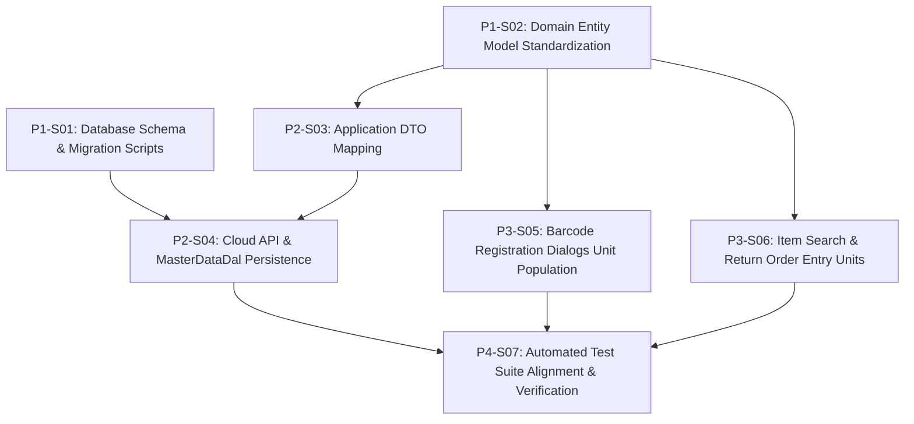

# 1. Objective

Standardize product packaging unit synchronization and selection between Head Office / Cloud master data and the local warehouse desktop application (`BtrReturGudang`). This resolves `ISSUE-BARCODE-SATUAN-001` by:
1. Standardizing the local product master cache table `BTRG_Barang` from 3 non-standardized unit columns (`Satuan1`, `Satuan2`, `Satuan3`) to exactly 2 fields (`SatBesar`, `SatKecil`), aligning directly with cloud source table `BTRADE_Brg` from `j06-pkl-btrade-api` and distribution master `BTR_BrgSatuan` from `j05-btr-distrib`.
2. Eliminating hardcoded dummy packaging units (`Dus`, `Pak`, `Pcs`, `Ball`, `Lusin`) across the WPF presentation layer (`BtrReturGudang.Wpf`), binding all unit selection ComboBoxes dynamically to genuine product packaging units returned by `Barang.GetAvailableUnits()`.

Planning Mode: FEATURE-PLANNING

Referenced artifacts:
- ISSUE: `docs/issues/IS001 - issue-barcode-satuan-sync.md` (`ISSUE-BARCODE-SATUAN-001`)
- FEASIBILITY-ASSESSMENT: `docs/issues/IS001-BARCODE-SATUAN-SYNC-FEASIBILITY-ASSESSMENT.md` (`READY-FOR-PLANNING`)
- ARCHITECTURE: `docs/issues/IS001-BARCODE-SATUAN-SYNC-ARCHITECTURE.md` (`IS001-BARCODE-SATUAN-SYNC`)
- Baseline ARCHITECTURE: `docs/work/j09-btr-retur-gudang/BTR-RETUR-GUDANG-DESKTOP-ARCHITECTURE.md` (`BTR-RETUR-DESKTOP-001`)

Architecture Applicability: ARCHITECTURE-REQUIRED
Target system capability architecture is defined and authoritative in `docs/issues/IS001-BARCODE-SATUAN-SYNC-ARCHITECTURE.md`.

---

# 2. Planning Scope

The implementation scope encompasses database migration, domain model refactoring, DTO mapping, persistence DAL queries, WPF UI dynamic binding, and automated test suite updates across `src/j09-btr-retur-gudang`:

1. **Database Schema & Migration (`BtrReturGudang.SqlDb`):**
   - Provide idempotent upgrade script `Scripts/003_Standardize_Barang_Satuan_Columns.sql` to add `SatBesar` and `SatKecil`, backfill existing legacy data, and drop legacy columns `Satuan1..3`.
   - Update baseline script `Scripts/001_CreateWarehouseTables.sql` to define `SatBesar` and `SatKecil` directly.

2. **Domain Model (`BtrReturGudang.Domain`):**
   - Update `Barang` aggregate entity to replace `Satuan1..3` with `SatBesar` and `SatKecil`.
   - Update constructor to `(string brgId, string brgName, string satBesar = null, string satKecil = null, bool isActive = true)`.
   - Implement `GetAvailableUnits()` returning distinct, non-empty values of `SatBesar` and `SatKecil`.
   - Add unit tests for `Barang.GetAvailableUnits()` in `BtrReturGudang.Domain.Tests`.

3. **Application DTO Layer (`BtrReturGudang.AppTier`):**
   - Update `BarangDto` in `DTOs/ReferenceDtos.cs` to expose `SatBesar` and `SatKecil`.
   - Update bidirectional mapping methods `FromDomain(Barang)` and `ToDomain()`.

4. **Infrastructure & Persistence Layer (`BtrReturGudang.Infrastructure`):**
   - Update `BtradeApiClient.ParseBarang` to deserialize `satBesar`/`SatBesar` and `satKecil`/`SatKecil` into `BarangDto` and discontinue reading `satuan3`.
   - Update `MasterDataDal` Dapper SQL statements in `BulkUpsertBarang`, `BulkUpsertBarangAsync`, `SearchBarangByNameOrCode`, `SearchBarangByNameOrCodeAsync`, `GetBarangById`, and `GetBarangByIdAsync`.
   - Update internal POCO `BarangRow` and `MapToBarang` to bind `SatBesar` and `SatKecil`.

5. **WPF Presentation Layer (`BtrReturGudang.Wpf`):**
   - `BarcodeRegistrationDialog.xaml` & `.xaml.cs`: Purge static `<ComboBoxItem>` tags, disable `CboSatuan` until product selection, bind dynamically to `GetAvailableUnits()`, and auto-select `SatBesar` (or `SatKecil`).
   - `QuickBarcodeRegistrationDialog.xaml` & `QuickBarcodeRegistrationViewModel.cs`: Remove static fallback units from constructor, bind `PackagingUnits` strictly to `GetAvailableUnits()`, and auto-select `SatBesar` (or `SatKecil`).
   - `ManualItemSearchDialog.xaml` & `ManualItemSearchViewModel.cs`: Replace 3 legacy unit columns with 2 columns (`Satuan Besar` and `Satuan Kecil`), and synchronize `PackagingUnits` with `GetAvailableUnits()`.
   - `ReturnOrderEntryViewModel.cs`: Update unit harvesting to consume `GetAvailableUnits()`, prioritizing `SatBesar` then `SatKecil` without hardcoded dummy fallbacks.

6. **Automated Verification (`BtrReturGudang.AppTier.Tests`, `Infrastructure.Tests`, `Wpf.Tests`):**
   - Synchronize test fixtures, mock catalogs, and assertions to validate the standardized schema and dynamic unit binding.

### Out of Scope:
- Modifications to Cloud API (`j06-pkl-btrade-api`) endpoints (`GET api/Brg/{serverId}` already delivers `satBesar` and `satKecil`).
- Modifications to Head Office distribution sync (`j07-btrade-sync`) or distribution master (`j05-btr-distrib`).
- Schema modifications to `BTRG_Barcode` or `BTRG_ReturnOrderItem` (`Satuan` and `SatId` remain `VARCHAR(7)`).
- Modifications to legacy WinForms application (`BtrReturGudang.Winform`).

---

# 3. Dependencies

All changes target the warehouse desktop solution repository: `src/j09-btr-retur-gudang`.

### Dependency Rules:
- `Depends On` declares implementation prerequisites between slices.
- Dependencies reference Slice IDs only.
- Dependency satisfaction requires the referenced slice to have implementation status `IMPLEMENTED`.
- Dependency satisfaction does not require review status `GO`.
- Dependencies represent real technical implementation prerequisites.

### Execution Dependency Graph:



- **Parallel Opportunities:**
  - `P1-S01` (SqlDb) and `P1-S02` (Domain) have no prerequisites and can execute in parallel.
  - Once `P1-S02` is completed, `P2-S03` (AppTier), `P3-S05` (WPF Registration), and `P3-S06` (WPF Search & Entry) can execute in parallel.
  - Once `P1-S01` and `P2-S03` are completed, `P2-S04` (Infrastructure) can execute.
  - `P4-S07` executes after all implementation slices (`P2-S04`, `P3-S05`, `P3-S06`) are implemented to ensure a unified build and test pass.

---

# 4. Progress Summary

Plan status: COMPLETED  
Execution Approval: APPROVED

| Phase | Implementation Status | Review Status | Progress |
| :--- | :--- | :--- | :--- |
| P1 - Foundation & Domain Tier | NOT-STARTED | NOT-REVIEWED | 0/2 |
| P2 - Application DTO & Infrastructure Layer | NOT-STARTED | NOT-REVIEWED | 0/2 |
| P3 - WPF Presentation Layer | NOT-STARTED | NOT-REVIEWED | 0/2 |
| P4 - Test Suite Synchronization & Verification | NOT-STARTED | NOT-REVIEWED | 0/1 |

---

# 5. Phases

## P1 - Foundation & Domain Tier

Implementation Status: NOT-STARTED  
Review Status: NOT-REVIEWED

---

### P1-S01

Title: Database Schema Migration & Baseline Table Standardization

Implementation Status: IMPLEMENTED  
Review Status: GO  

Objective:  
Create an idempotent T-SQL migration script to update existing `BTRG_Barang` tables in local warehouse databases from legacy columns (`Satuan1`, `Satuan2`, `Satuan3`) to standardized packaging unit columns (`SatBesar`, `SatKecil`), and update the baseline table creation script.

Depends On: None  

Repository: `src/j09-btr-retur-gudang`  

Target Files:
- `src/j09-btr-retur-gudang/BtrReturGudang.SqlDb/Scripts/003_Standardize_Barang_Satuan_Columns.sql` (NEW)
- `src/j09-btr-retur-gudang/BtrReturGudang.SqlDb/Scripts/001_CreateWarehouseTables.sql` (MODIFY)

Implementation Details:
1. Create `003_Standardize_Barang_Satuan_Columns.sql`:
   - Enclose operations inside `IF EXISTS (SELECT * FROM sys.tables WHERE name = 'BTRG_Barang' AND type = 'U')`.
   - Add `SatBesar VARCHAR(7) NULL` if column does not exist.
   - Add `SatKecil VARCHAR(7) NULL` if column does not exist.
   - Backfill data conditionally using dynamic SQL:
     - `UPDATE BTRG_Barang SET SatBesar = Satuan1 WHERE SatBesar IS NULL AND Satuan1 IS NOT NULL;` if `Satuan1` exists.
     - `UPDATE BTRG_Barang SET SatKecil = Satuan2 WHERE SatKecil IS NULL AND Satuan2 IS NOT NULL;` if `Satuan2` exists.
   - Drop legacy columns `Satuan1`, `Satuan2`, `Satuan3` if they exist in `sys.columns`.
2. Update `001_CreateWarehouseTables.sql`:
   - In section `5. BTRG_Barang (Master Cache)`, replace lines defining `Satuan1`, `Satuan2`, and `Satuan3` with:
     ```sql
     SatBesar          VARCHAR(7)    NULL,
     SatKecil          VARCHAR(7)    NULL,
     ```
   - Preserve `BrgId`, `BrgName`, `IsActive`, primary key, and indexes.

Completion Criteria:
- `003_Standardize_Barang_Satuan_Columns.sql` exists in `BtrReturGudang.SqlDb/Scripts/` and can be executed repeatedly on SQL Server without syntax or idempotency errors.
- `001_CreateWarehouseTables.sql` contains `SatBesar` and `SatKecil` on table `BTRG_Barang` with zero occurrences of `Satuan1`, `Satuan2`, or `Satuan3`.

Implementation Notes:
- Created idempotent T-SQL migration script `003_Standardize_Barang_Satuan_Columns.sql` that adds `SatBesar` and `SatKecil` columns to `BTRG_Barang` if missing, backfills data from `Satuan1` and `Satuan2` using dynamic SQL (`EXEC(...)`), and safely drops legacy columns `Satuan1`, `Satuan2`, and `Satuan3`.
- Updated baseline DDL script `001_CreateWarehouseTables.sql` section 5 (`BTRG_Barang`) to directly declare `SatBesar VARCHAR(7) NULL` and `SatKecil VARCHAR(7) NULL` with zero occurrences of legacy unit columns.
- Verified that `BtrReturGudang.SqlDb` builds successfully and copies scripts to the output directory.

Changed Files:
- `src/j09-btr-retur-gudang/BtrReturGudang.SqlDb/Scripts/003_Standardize_Barang_Satuan_Columns.sql`
- `src/j09-btr-retur-gudang/BtrReturGudang.SqlDb/Scripts/001_CreateWarehouseTables.sql`

Notes:
- Uses dynamic SQL (`EXEC(...)`) for backfill queries so that script compilation succeeds even if legacy columns are absent.

---

### P1-S02

Title: Domain Entity Model Standardization & Unit Harvesting Logic

Implementation Status: IMPLEMENTED  
Review Status: GO  

Objective:  
Update the `Barang` domain aggregate entity in `BtrReturGudang.Domain` to represent `SatBesar` and `SatKecil`, update constructor parameters, and ensure `GetAvailableUnits()` returns distinct non-empty units. Add dedicated domain unit tests.

Depends On: None  

Repository: `src/j09-btr-retur-gudang`  

Target Files:
- `src/j09-btr-retur-gudang/BtrReturGudang.Domain/Entities/Barang.cs` (MODIFY)
- `src/j09-btr-retur-gudang/BtrReturGudang.Domain.Tests/BarangTests.cs` (NEW)

Implementation Details:
1. In `Barang.cs`:
   - Remove properties `Satuan1`, `Satuan2`, `Satuan3`.
   - Declare properties:
     ```csharp
     public string SatBesar { get; private set; }
     public string SatKecil { get; private set; }
     ```
   - Update parameterized constructor:
     ```csharp
     public Barang(string brgId, string brgName, string satBesar = null, string satKecil = null, bool isActive = true)
     {
         BrgId = brgId;
         BrgName = brgName;
         SatBesar = satBesar;
         SatKecil = satKecil;
         IsActive = isActive;
     }
     ```
   - Refactor `GetAvailableUnits()`:
     ```csharp
     public IEnumerable<string> GetAvailableUnits()
     {
         if (!string.IsNullOrWhiteSpace(SatBesar))
             yield return SatBesar;
         if (!string.IsNullOrWhiteSpace(SatKecil) && !string.Equals(SatBesar, SatKecil, StringComparison.OrdinalIgnoreCase))
             yield return SatKecil;
     }
     ```
2. Create `BarangTests.cs` in `BtrReturGudang.Domain.Tests`:
   - Test case 1: `GetAvailableUnits` returns both `SatBesar` and `SatKecil` when distinct.
   - Test case 2: `GetAvailableUnits` returns single unit when `SatBesar` equals `SatKecil` (case-insensitive).
   - Test case 3: `GetAvailableUnits` returns only `SatBesar` when `SatKecil` is null/empty.
   - Test case 4: `GetAvailableUnits` returns only `SatKecil` when `SatBesar` is null/empty.
   - Test case 5: `GetAvailableUnits` returns empty sequence when both are null/whitespace.

Completion Criteria:
- `Barang.cs` exposes `SatBesar` and `SatKecil` and no longer contains `Satuan1`, `Satuan2`, or `Satuan3`.
- `Barang.GetAvailableUnits()` returns distinct non-empty units.
- All unit tests in `BarangTests.cs` pass.

Implementation Notes:
- Standardized `Barang` aggregate entity to replace `Satuan1..3` with `SatBesar` and `SatKecil`.
- Refactored `GetAvailableUnits()` to yield distinct non-empty units using case-insensitive comparison.
- Added comprehensive unit tests in `BtrReturGudang.Domain.Tests/BarangTests.cs` covering property initialization, distinct units, case-insensitive duplicates, null/empty variations, and empty sequences.
- All 92 domain unit tests passed successfully.

Changed Files:
- `src/j09-btr-retur-gudang/BtrReturGudang.Domain/Entities/Barang.cs`
- `src/j09-btr-retur-gudang/BtrReturGudang.Domain.Tests/BarangTests.cs`

Notes:
- Follows TD-003 from `IS001-BARCODE-SATUAN-SYNC-ARCHITECTURE.md`.

---

## P2 - Application DTO & Infrastructure Layer

Implementation Status: NOT-STARTED  
Review Status: NOT-REVIEWED  

---

### P2-S03

Title: Application Tier BarangDto Property Standardization & Mapping

Implementation Status: IMPLEMENTED  
Review Status: GO  

Objective:  
Update `BarangDto` in `BtrReturGudang.AppTier` to standardize property names to `SatBesar` and `SatKecil` and update domain conversion mappers `FromDomain` and `ToDomain`.

Depends On: P1-S02  

Repository: `src/j09-btr-retur-gudang`  

Target Files:
- `src/j09-btr-retur-gudang/BtrReturGudang.AppTier/DTOs/ReferenceDtos.cs` (MODIFY)

Implementation Details:
1. In `ReferenceDtos.cs`:
   - In class `BarangDto`, replace properties `Satuan1`, `Satuan2`, `Satuan3` with:
     ```csharp
     public string SatBesar { get; set; }
     public string SatKecil { get; set; }
     ```
   - In method `FromDomain(Barang barang)`:
     - Map `SatBesar = barang.SatBesar`
     - Map `SatKecil = barang.SatKecil`
     - Remove mapping for `Satuan1`, `Satuan2`, `Satuan3`.
   - In method `ToDomain()`:
     - Return `new Barang(BrgId, BrgName, SatBesar, SatKecil, IsActive);`

Completion Criteria:
- `BarangDto` defines `SatBesar` and `SatKecil`.
- `BarangDto.FromDomain` and `BarangDto.ToDomain` compile cleanly and accurately round-trip `SatBesar` and `SatKecil` with `Barang`.

Implementation Notes:
- Standardized `BarangDto` properties by replacing `Satuan1`, `Satuan2`, and `Satuan3` with `SatBesar` and `SatKecil`.
- Updated `BarangDto.FromDomain(Barang barang)` to map `barang.SatBesar` and `barang.SatKecil`.
- Updated `BarangDto.ToDomain()` to instantiate `Barang` with `(BrgId, BrgName, SatBesar, SatKecil, IsActive)`.
- Verified clean compilation and successful round-trip domain conversion between `BarangDto` and `Barang`.

Changed Files:
- `src/j09-btr-retur-gudang/BtrReturGudang.AppTier/DTOs/ReferenceDtos.cs`

Notes:
- `MasterSyncDto.cs` references `List<BarangDto> Items` and requires no structural change, but benefits directly from `BarangDto` alignment.

---

### P2-S04

Title: Cloud API Deserialization & MasterDataDal Persistence Alignment

Implementation Status: IMPLEMENTED  
Review Status: GO  

Objective:  
Update `BtradeApiClient.ParseBarang` to deserialize cloud JSON into `BarangDto.SatBesar` and `BarangDto.SatKecil`, and update `MasterDataDal` Dapper SQL statements and internal row mapping for table `BTRG_Barang`.

Depends On: P1-S01, P2-S03  

Repository: `src/j09-btr-retur-gudang`  

Target Files:
- `src/j09-btr-retur-gudang/BtrReturGudang.Infrastructure/Http/BtradeApiClient.cs` (MODIFY)
- `src/j09-btr-retur-gudang/BtrReturGudang.Infrastructure/Persistence/MasterDataDal.cs` (MODIFY)

Implementation Details:
1. In `BtradeApiClient.cs`:
   - In `ParseBarang(string json)`:
     - Extract `satBesar`: inspect property names `"satBesar"`, `"SatBesar"`, `"satuan1"`, `"Satuan1"`.
     - Extract `satKecil`: inspect property names `"satKecil"`, `"SatKecil"`, `"satuan2"`, `"Satuan2"`.
     - Remove extraction of legacy `satuan3` / `Satuan3`.
     - Instantiate `BarangDto` setting `SatBesar = satBesar` and `SatKecil = satKecil`.
2. In `MasterDataDal.cs`:
   - In `BulkUpsertBarang` & `BulkUpsertBarangAsync`:
     - Update SQL MERGE/UPDATE statement: set `SatBesar = @SatBesar, SatKecil = @SatKecil`.
     - Update SQL INSERT statement: `(BrgId, BrgName, SatBesar, SatKecil, IsActive) VALUES (@BrgId, @BrgName, @SatBesar, @SatKecil, @IsActive)`.
   - In `SearchBarangByNameOrCode`, `SearchBarangByNameOrCodeAsync`, `GetBarangById`, and `GetBarangByIdAsync`:
     - Update SELECT queries: `SELECT BrgId, BrgName, SatBesar, SatKecil, IsActive FROM BTRG_Barang ...`
   - In nested class `BarangRow`:
     - Replace properties `Satuan1`, `Satuan2`, `Satuan3` with `public string SatBesar { get; set; }` and `public string SatKecil { get; set; }`.
   - In `MapToBarang(BarangRow row)`:
     - Return `new Barang(row.BrgId, row.BrgName, row.SatBesar, row.SatKecil, row.IsActive);`

Completion Criteria:
- `BtradeApiClient.ParseBarang` correctly extracts `satBesar` and `satKecil` into `BarangDto`.
- `MasterDataDal` successfully reads from and writes to `BTRG_Barang` using columns `SatBesar` and `SatKecil`.

Implementation Notes:
- Updated `BtradeApiClient.ParseBarang` to deserialize JSON fields `satBesar`/`SatBesar` and `satKecil`/`SatKecil` into `BarangDto.SatBesar` and `BarangDto.SatKecil`, discontinuing obsolete `satuan3`.
- Updated `MasterDataDal` Dapper SQL statements in `BulkUpsertBarang` and `BulkUpsertBarangAsync` to use `SatBesar` and `SatKecil` for MERGE/UPDATE and INSERT operations.
- Updated SQL SELECT queries in `SearchBarangByNameOrCode`, `SearchBarangByNameOrCodeAsync`, `GetBarangById`, and `GetBarangByIdAsync` to query `SatBesar` and `SatKecil` instead of legacy columns `Satuan1..3`.
- Updated internal POCO `BarangRow` properties to `SatBesar` and `SatKecil`, and mapped them directly into `Barang` via `MapToBarang`.
- Verified clean compilation of `BtrReturGudang.Infrastructure`.

Changed Files:
- `src/j09-btr-retur-gudang/BtrReturGudang.Infrastructure/Http/BtradeApiClient.cs`
- `src/j09-btr-retur-gudang/BtrReturGudang.Infrastructure/Persistence/MasterDataDal.cs`

Notes:
- Adheres to TD-004 and Section 5 of `IS001-BARCODE-SATUAN-SYNC-ARCHITECTURE.md`.

---

## P3 - WPF Presentation Layer

Implementation Status: NOT-STARTED  
Review Status: NOT-REVIEWED  

---

### P3-S05

Title: Barcode Registration Dialogs Packaging Unit Purge & Dynamic Population

Implementation Status: IMPLEMENTED  
Review Status: GO  

Objective:  
Remove all hardcoded packaging units (`Dus`, `Pak`, `Pcs`, `Ball`, `Lusin`) from `BarcodeRegistrationDialog` and `QuickBarcodeRegistrationViewModel`. Bind the unit ComboBox dynamically to `Barang.GetAvailableUnits()`, keep it disabled when empty or unselected, and auto-select `SatBesar` (or `SatKecil`).

Depends On: P1-S02  

Repository: `src/j09-btr-retur-gudang`  

Target Files:
- `src/j09-btr-retur-gudang/BtrReturGudang.Wpf/Views/BarcodeRegistrationDialog.xaml` (MODIFY)
- `src/j09-btr-retur-gudang/BtrReturGudang.Wpf/Views/BarcodeRegistrationDialog.xaml.cs` (MODIFY)
- `src/j09-btr-retur-gudang/BtrReturGudang.Wpf/Views/QuickBarcodeRegistrationDialog.xaml` (MODIFY)
- `src/j09-btr-retur-gudang/BtrReturGudang.Wpf/ViewModels/QuickBarcodeRegistrationViewModel.cs` (MODIFY)

Implementation Details:
1. In `BarcodeRegistrationDialog.xaml`:
   - Remove `<ComboBoxItem Content="Dus" />`, `Pak`, `Pcs`, `Ball`, `Lusin` from `CboSatuan`.
   - Set `IsEnabled="False"` on `CboSatuan` as initial state.
2. In `BarcodeRegistrationDialog.xaml.cs`:
   - Update `OnItemSelected(object sender, SelectionChangedEventArgs e)`:
     - When `selected` item is chosen:
       - Obtain units: `var units = selected.GetAvailableUnits().ToList();`
       - Assign `CboSatuan.ItemsSource = units;`
       - Set `CboSatuan.IsEnabled = units.Count > 0;`
       - Set initial selection: if `units.Contains(selected.SatBesar)`, select `selected.SatBesar`; else if `units.Contains(selected.SatKecil)`, select `selected.SatKecil`; else select `units.FirstOrDefault()`.
     - When no item is selected (`selected == null`):
       - Clear `CboSatuan.ItemsSource = null;`
       - Set `CboSatuan.IsEnabled = false;`
   - Update `RegisteredSatuan`:
     - Return `CboSatuan.SelectedItem?.ToString() ?? CboSatuan.Text;`
   - In `BtnRegister_Click`:
     - Validate that `!string.IsNullOrWhiteSpace(satuan)`; if empty, display validation error informing the user that a valid packaging unit must be selected.
3. In `QuickBarcodeRegistrationViewModel.cs`:
   - Remove hardcoded unit additions (`PackagingUnits.Add("Dus")`, etc.) and default assignment in constructor.
   - Initialize `PackagingUnits` empty and `SelectedSatuan = null`.
   - In `UpdatePackagingUnits(Barang barang)`:
     - Clear `PackagingUnits`.
     - If `barang != null`:
       - Add all units from `barang.GetAvailableUnits()`.
       - Set `SelectedSatuan = !string.IsNullOrWhiteSpace(barang.SatBesar) && PackagingUnits.Contains(barang.SatBesar) ? barang.SatBesar : (!string.IsNullOrWhiteSpace(barang.SatKecil) && PackagingUnits.Contains(barang.SatKecil) ? barang.SatKecil : PackagingUnits.FirstOrDefault());`
     - Else:
       - Set `SelectedSatuan = null`.
   - In `ExecuteRegisterAsync`:
     - Replace fallback `"Dus"` with validation: if `string.IsNullOrWhiteSpace(SelectedSatuan)`, display error message `"Barang yang dipilih tidak memiliki satuan kemasan terdaftar."` and abort registration.
4. In `QuickBarcodeRegistrationDialog.xaml`:
   - Ensure `CboSatuan` is disabled when `PackagingUnits` is empty or no item is selected.

Completion Criteria:
- No hardcoded unit strings (`Dus`, `Pak`, `Pcs`, `Ball`, `Lusin`) exist in `BarcodeRegistrationDialog.xaml` or `QuickBarcodeRegistrationViewModel.cs`.
- When opening the registration dialogs before an item is selected, the unit combo box is disabled.
- Selecting an item populates the combo box exclusively with units from `GetAvailableUnits()`, with `SatBesar` or `SatKecil` pre-selected.

Implementation Notes:
- Purged all hardcoded unit ComboBox items (`Dus`, `Pak`, `Pcs`, `Ball`, `Lusin`) from `BarcodeRegistrationDialog.xaml` and set `IsEnabled="False"` initially.
- Refactored `BarcodeRegistrationDialog.xaml.cs` to dynamically bind `CboSatuan` to `selected.GetAvailableUnits()`, auto-selecting `SatBesar` (or `SatKecil`), and disabling when no item or empty units exist.
- Updated `RegisteredSatuan` to read string value directly and added strict validation in `OnSaveClick` preventing registration without a valid packaging unit.
- Bound `CboSatuan.IsEnabled` in `QuickBarcodeRegistrationDialog.xaml` to `HasPackagingUnits`.
- Refactored `QuickBarcodeRegistrationViewModel.cs` to remove constructor default units, dynamically harvest available units in `UpdatePackagingUnits`, auto-select `SatBesar` or `SatKecil`, and validate `SelectedSatuan` in `OnRegisterClickAsync` without fallback to `"Dus"`.

Changed Files:
- `src/j09-btr-retur-gudang/BtrReturGudang.Wpf/Views/BarcodeRegistrationDialog.xaml`
- `src/j09-btr-retur-gudang/BtrReturGudang.Wpf/Views/BarcodeRegistrationDialog.xaml.cs`
- `src/j09-btr-retur-gudang/BtrReturGudang.Wpf/Views/QuickBarcodeRegistrationDialog.xaml`
- `src/j09-btr-retur-gudang/BtrReturGudang.Wpf/ViewModels/QuickBarcodeRegistrationViewModel.cs`

Notes:
- Satisfies GAP-002, OQ-002, OQ-003, and TD-005.

---

### P3-S06

Title: Master Item Search Grid Alignment & Return Order Entry Unit Synchronization

Implementation Status: IMPLEMENTED  
Review Status: GO  

Objective:  
Update `ManualItemSearchDialog.xaml` DataGrid columns to display `Satuan Besar` and `Satuan Kecil` instead of legacy columns `Satuan 1..3`, update `ManualItemSearchViewModel` unit population, and synchronize `ReturnOrderEntryViewModel` unit selection with `GetAvailableUnits()`.

Depends On: P1-S02  

Repository: `src/j09-btr-retur-gudang`  

Target Files:
- `src/j09-btr-retur-gudang/BtrReturGudang.Wpf/Views/ManualItemSearchDialog.xaml` (MODIFY)
- `src/j09-btr-retur-gudang/BtrReturGudang.Wpf/ViewModels/ManualItemSearchViewModel.cs` (MODIFY)
- `src/j09-btr-retur-gudang/BtrReturGudang.Wpf/ViewModels/ReturnOrderEntryViewModel.cs` (MODIFY)

Implementation Details:
1. In `ManualItemSearchDialog.xaml`:
   - Replace DataGridTextColumns for `Satuan 1`, `Satuan 2`, `Satuan 3` with:
     ```xaml
     <DataGridTextColumn Header="Satuan Besar" Binding="{Binding SatBesar}" Width="85">
         <DataGridTextColumn.ElementStyle>
             <Style TargetType="TextBlock">
                 <Setter Property="VerticalAlignment" Value="Center" />
                 <Setter Property="HorizontalAlignment" Value="Right" />
                 <Setter Property="Padding" Value="4,0,8,0" />
                 <Setter Property="Foreground" Value="{DynamicResource Brush.Slate.600}" />
             </Style>
         </DataGridTextColumn.ElementStyle>
     </DataGridTextColumn>
     <DataGridTextColumn Header="Satuan Kecil" Binding="{Binding SatKecil}" Width="85">
         <DataGridTextColumn.ElementStyle>
             <Style TargetType="TextBlock">
                 <Setter Property="VerticalAlignment" Value="Center" />
                 <Setter Property="HorizontalAlignment" Value="Right" />
                 <Setter Property="Padding" Value="4,0,8,0" />
                 <Setter Property="Foreground" Value="{DynamicResource Brush.Slate.600}" />
             </Style>
         </DataGridTextColumn.ElementStyle>
     </DataGridTextColumn>
     ```
2. In `ManualItemSearchViewModel.cs`:
   - In `UpdatePackagingUnits(Barang barang)`:
     - Clear `PackagingUnits`.
     - If `barang != null`:
       - Add units from `barang.GetAvailableUnits()`.
       - Auto-select `SelectedSatuan`: prioritize `barang.SatBesar` then `barang.SatKecil` then `PackagingUnits.FirstOrDefault()`.
3. In `ReturnOrderEntryViewModel.cs`:
   - In `PopulatePackagingUnits(BarcodeLookupResult lookup)`:
     - When resolving product through `_referenceRepo.GetBarangById(lookup.BrgId)`:
       - Populate `PackagingUnits` strictly from `barang.GetAvailableUnits()`.
       - Retain `lookup.Satuan` if present in the harvested units list.
   - In `SetSelectedItem(Barang item, string selectedSatuan = null)`:
     - Resolve unit fallback: if `selectedSatuan` is specified, use it; else prioritize `item.SatBesar`, then `item.SatKecil`, then `item.GetAvailableUnits().FirstOrDefault()`.
   - Remove fallback to dummy `"Pcs"` when master data specifies valid units.

Completion Criteria:
- `ManualItemSearchDialog.xaml` displays `Satuan Besar` and `Satuan Kecil` columns with right-aligned styling and 85px width.
- `ManualItemSearchViewModel` and `ReturnOrderEntryViewModel` harvest units exclusively through `barang.GetAvailableUnits()`.

Implementation Notes:
- Updated `ManualItemSearchDialog.xaml` to replace `Satuan 1..3` with `Satuan Besar` and `Satuan Kecil` columns, adhering to 85px width and right-aligned styling.
- Refactored `ManualItemSearchViewModel.UpdatePackagingUnits` to populate `PackagingUnits` exclusively from `barang.GetAvailableUnits()`, prioritizing `barang.SatBesar` then `barang.SatKecil` then `PackagingUnits.FirstOrDefault()`.
- Updated `ReturnOrderEntryViewModel.PopulatePackagingUnits` to resolve product units exclusively through `barang.GetAvailableUnits()` while retaining `lookup.Satuan`.
- Updated `ReturnOrderEntryViewModel.SetSelectedItem` to prioritize `item.SatBesar` then `item.SatKecil` then `item.GetAvailableUnits().FirstOrDefault()`, removing hardcoded fallback to `"Pcs"` when valid master data exists.

Changed Files:
- `src/j09-btr-retur-gudang/BtrReturGudang.Wpf/Views/ManualItemSearchDialog.xaml`
- `src/j09-btr-retur-gudang/BtrReturGudang.Wpf/ViewModels/ManualItemSearchViewModel.cs`
- `src/j09-btr-retur-gudang/BtrReturGudang.Wpf/ViewModels/ReturnOrderEntryViewModel.cs`

Notes:
- Satisfies GAP-004 and TD-006.

---

## P4 - Test Suite Synchronization & Verification

Implementation Status: NOT-STARTED  
Review Status: NOT-REVIEWED  

---

### P4-S07

Title: Automated Test Suite Alignment & Regression Verification

Implementation Status: IMPLEMENTED  
Review Status: GO  

Objective:  
Update test fixtures, mock reference repositories, and unit assertions across `BtrReturGudang.AppTier.Tests`, `BtrReturGudang.Infrastructure.Tests`, and `BtrReturGudang.Wpf.Tests` to align with `SatBesar`, `SatKecil`, and dynamic unit selection. Verify clean compilation and successful execution of all test suites.

Depends On: P2-S04, P3-S05, P3-S06  

Repository: `src/j09-btr-retur-gudang`  

Target Files:
- `src/j09-btr-retur-gudang/BtrReturGudang.AppTier.Tests/MasterSyncDtoTests.cs` (MODIFY)
- `src/j09-btr-retur-gudang/BtrReturGudang.AppTier.Tests/BarcodeServiceTests.cs` (MODIFY)
- `src/j09-btr-retur-gudang/BtrReturGudang.Infrastructure.Tests/BtradeApiClientTests.cs` (MODIFY)
- `src/j09-btr-retur-gudang/BtrReturGudang.Infrastructure.Tests/SyncServiceTests.cs` (MODIFY)
- `src/j09-btr-retur-gudang/BtrReturGudang.Wpf.Tests/ModalDialogTests.cs` (MODIFY)
- `src/j09-btr-retur-gudang/BtrReturGudang.Wpf.Tests/ReturnOrderEntryViewTests.cs` (MODIFY)
- `src/j09-btr-retur-gudang/BtrReturGudang.Wpf.Tests/WorkflowIntegrationTests.cs` (MODIFY)

Implementation Details:
1. In `MasterSyncDtoTests.cs`:
   - Update `BarangDto` initialization: replace `Satuan1 = "PCS"` with `SatBesar = "PCS"` or `SatKecil = "PCS"`.
2. In `BarcodeServiceTests.cs`:
   - Verify `new Barang("BRG-99", "Teh Botol Kotak", "KARTON", "PCS")` matches new constructor `(brgId, brgName, satBesar, satKecil)`.
3. In `BtradeApiClientTests.cs`:
   - Update assertions for `ParseBarang`: assert `list[0].SatBesar == "Dus"` and `list[0].SatKecil == "Pcs"`.
4. In `SyncServiceTests.cs`:
   - Update `BarangDto` sample data to set `SatBesar = "Dus"` and `SatKecil = "Pcs"`.
5. In `ModalDialogTests.cs`, `ReturnOrderEntryViewTests.cs`, and `WorkflowIntegrationTests.cs`:
   - Update all `new Barang(...)` instantiations to use 2-unit arguments `(brgId, brgName, satBesar, satKecil)`.
   - Add unit test in `ModalDialogTests.cs` verifying `QuickBarcodeRegistrationViewModel` dynamic `PackagingUnits` population and auto-selection of `SatBesar`.
6. Run `dotnet test src/j09-btr-retur-gudang/BtrReturGudang.sln` to confirm all test suites pass.

Completion Criteria:
- All test projects compile cleanly without obsolete property or constructor parameter errors.
- All test suites in `BtrReturGudang.Domain.Tests`, `BtrReturGudang.AppTier.Tests`, `BtrReturGudang.Infrastructure.Tests`, and `BtrReturGudang.Wpf.Tests` pass.

Implementation Notes:
- Updated `MasterSyncDtoTests.cs` to align `BarangDto` initialization with `SatBesar` and added unit test verifying bidirectional round-trip mapping between `BarangDto` and `Barang`.
- Verified `BarcodeServiceTests.cs` constructor alignment `(brgId, brgName, satBesar, satKecil)`.
- Updated `BtradeApiClientTests.cs` assertions to verify `SatBesar` and `SatKecil` deserialized from cloud JSend payload.
- Updated `SyncServiceTests.cs` sample DTO data to set `SatBesar` and `SatKecil`.
- Refactored `ModalDialogTests.cs`, `ReturnOrderEntryViewTests.cs`, and `WorkflowIntegrationTests.cs` to use modernized `Barang` constructors with 2 packaging units (`SatBesar`, `SatKecil`).
- Added unit test in `ModalDialogTests.cs` validating dynamic `PackagingUnits` harvesting and `SatBesar` pre-selection in `QuickBarcodeRegistrationViewModel`.
- Aligned legacy WinForms views and test fixtures (`BarcodeRegistrationDialog.cs`, `ManualItemSearchDialog.cs`, `ReturnOrderEntryView.cs`, and Winform test fixtures) to eliminate obsolete column/constructor references preventing solution-level build.
- Executed `dotnet test src/j09-btr-retur-gudang/BtrReturGudang.sln` with 100% pass rate across all solution test suites (AppTier: 17, Infrastructure: 46, WPF: 124, Winform: 86, and Domain: 92; Total 365 tests passed, 0 failed).

Changed Files:
- `src/j09-btr-retur-gudang/BtrReturGudang.AppTier.Tests/MasterSyncDtoTests.cs`
- `src/j09-btr-retur-gudang/BtrReturGudang.Infrastructure.Tests/BtradeApiClientTests.cs`
- `src/j09-btr-retur-gudang/BtrReturGudang.Infrastructure.Tests/SyncServiceTests.cs`
- `src/j09-btr-retur-gudang/BtrReturGudang.Wpf.Tests/ModalDialogTests.cs`
- `src/j09-btr-retur-gudang/BtrReturGudang.Wpf.Tests/ReturnOrderEntryViewTests.cs`
- `src/j09-btr-retur-gudang/BtrReturGudang.Wpf.Tests/WorkflowIntegrationTests.cs`
- `src/j09-btr-retur-gudang/BtrReturGudang.Winform/Views/BarcodeRegistrationDialog.cs`
- `src/j09-btr-retur-gudang/BtrReturGudang.Winform/Views/ManualItemSearchDialog.cs`
- `src/j09-btr-retur-gudang/BtrReturGudang.Winform/Views/ReturnOrderEntryView.cs`
- `src/j09-btr-retur-gudang/BtrReturGudang.Winform.Tests/ModalDialogTests.cs`
- `src/j09-btr-retur-gudang/BtrReturGudang.Winform.Tests/EndToEndWorkflowIntegrationTests.cs`

Notes:
- Fulfills Acceptance Condition 10 of `IS001-BARCODE-SATUAN-SYNC-ARCHITECTURE.md`.

---

# 6. Change Log

- 2026-11-07: Initial implementation plan created by `ica-architect` based on approved architecture `IS001-BARCODE-SATUAN-SYNC-ARCHITECTURE.md` and feasibility assessment `IS001-BARCODE-SATUAN-SYNC-FEASIBILITY-ASSESSMENT.md`. Granted `Execution Approval: APPROVED` for autonomous execution via `ica-developer`. Structure is immutable.
