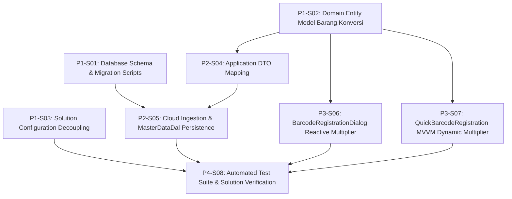

# 1. Objective

Enable storing the product conversion multiplier in the local warehouse database cache (`BTRG_Barang.Konversi`) and automatically populating/recalculating it as a read-only field within the barcode registration dialogs (`BarcodeRegistrationDialog` and `QuickBarcodeRegistrationDialog`) of the warehouse desktop application (`BtrReturGudang.Wpf`).

Specifically, it realizes change request `BTRG-BARCODE-KONVERSI-001` by:
1. Enhancing the local product master cache table `BTRG_Barang` with `Konversi INT NOT NULL CONSTRAINT DF_BTRG_Barang_Konversi DEFAULT 1`, harmonizing schema and synchronization with cloud catalog `BTRADE_Brg` from `j06-pkl-btrade-api` and distribution master `BTR_BrgSatuan` from `j05-btr-distrib`.
2. Extending domain entity `Barang`, DTO `BarangDto`, cloud JSON deserializer `BtradeApiClient`, and persistence mapper `MasterDataDal` to ingest, persist, and expose `Konversi`.
3. Encapsulating unit conversion resolution logic within domain aggregate method `Barang.GetConversionForUnit(string satuan)`.
4. Enforcing strict master data integrity by locking `TxtPengali` (`IsReadOnly="True"`) across both `BarcodeRegistrationDialog.xaml` and `QuickBarcodeRegistrationDialog.xaml`, and dynamically updating the multiplier whenever an item is picked or the packaging unit selection changes.
5. Streamlining the solution build configuration by excluding legacy WinForms projects (`BtrReturGudang.Winform`, `BtrReturGudang.Winform.Tests`) from `BtrReturGudang.sln` and registering `BtrReturGudang.Domain.Tests`.

Planning Mode: FEATURE-PLANNING

Referenced artifacts:
- ISSUE: `docs/issues/IS002 - BTRG-BARCODE-KONVERSI-AUTOFILL-ISSUE.md` (`BTRG-BARCODE-KONVERSI-001`)
- FEASIBILITY-ASSESSMENT: `docs/issues/IS002-BTRG-BARCODE-KONVERSI-AUTOFILL-FEASIBILITY-ASSESSMENT.md` (`IS002-BTRG-BARCODE-KONVERSI-AUTOFILL`) (Status: `READY-FOR-PLANNING`)
- ARCHITECTURE: `docs/issues/IS002-BTRG-BARCODE-KONVERSI-AUTOFILL-ARCHITECTURE.md` (`IS002-BTRG-BARCODE-KONVERSI-AUTOFILL`)
- Baseline ARCHITECTURE: `docs/work/j09-btr-retur-gudang/BTR-RETUR-GUDANG-DESKTOP-ARCHITECTURE.md` (`BTR-RETUR-DESKTOP-001`)
- Related ARCHITECTURE: `docs/issues/IS001-BARCODE-SATUAN-SYNC-ARCHITECTURE.md` (`IS001-BARCODE-SATUAN-SYNC`)

Architecture Applicability: ARCHITECTURE-REQUIRED  
Target system capability architecture is defined and authoritative in `docs/issues/IS002-BTRG-BARCODE-KONVERSI-AUTOFILL-ARCHITECTURE.md`.

---

# 2. Planning Scope

The implementation scope encompasses database migration, domain model extension, solution build decoupling, DTO mapping, persistence DAL queries, WPF UI dynamic binding, and automated test suite updates across `src/j09-btr-retur-gudang`:

1. **Database Schema & Migration (`BtrReturGudang.SqlDb`):**
   - Provide idempotent upgrade script `Scripts/004_Add_Barang_Konversi_Column.sql` to add `Konversi INT NOT NULL CONSTRAINT DF_BTRG_Barang_Konversi DEFAULT 1` to `BTRG_Barang` and backfill non-positive or null values to `1`.
   - Update baseline script `Scripts/001_CreateWarehouseTables.sql` to define `Konversi` directly on `BTRG_Barang`.

2. **Domain Model (`BtrReturGudang.Domain`):**
   - Update `Barang` aggregate entity to add property `public int Konversi { get; private set; }`.
   - Update constructor parameters to accept `int konversi = 1` with defensive fallback (`konversi <= 0 ? 1 : konversi`).
   - Implement business helper method `public int GetConversionForUnit(string satuan)` resolving `Konversi` for `SatBesar`, `1` for `SatKecil`, and fallback `1`.
   - Update unit tests in `BtrReturGudang.Domain.Tests/BarangTests.cs`.

3. **Solution Configuration (`BtrReturGudang.sln`):**
   - Decouple legacy WinForms projects (`BtrReturGudang.Winform` and `BtrReturGudang.Winform.Tests`) from `BtrReturGudang.sln`.
   - Register `BtrReturGudang.Domain.Tests` project in `BtrReturGudang.sln` to include domain unit tests in standard solution builds and continuous verification.

4. **Application DTO Layer (`BtrReturGudang.AppTier`):**
   - Update `BarangDto` in `DTOs/ReferenceDtos.cs` to expose `public int Konversi { get; set; } = 1;`.
   - Update bidirectional mapping methods `FromDomain(Barang)` and `ToDomain()`.
   - Update unit tests in `BtrReturGudang.AppTier.Tests/MasterSyncDtoTests.cs`.

5. **Infrastructure & Persistence Layer (`BtrReturGudang.Infrastructure`):**
   - Update `BtradeApiClient`: implement private helper `GetIntProp` and update `ParseBarang(string json)` to deserialize `konversi`/`Konversi` into `BarangDto.Konversi`, defaulting safely to `1`.
   - Update `MasterDataDal` Dapper SQL statements in `BulkUpsertBarang`, `BulkUpsertBarangAsync`, `SearchBarangByNameOrCode`, `SearchBarangByNameOrCodeAsync`, `GetBarangById`, and `GetBarangByIdAsync`.
   - Update internal POCO `BarangRow` and `MapToBarang` to bind and pass `Konversi`.
   - Update unit tests in `BtrReturGudang.Infrastructure.Tests/BtradeApiClientTests.cs`.

6. **WPF Presentation Layer (`BtrReturGudang.Wpf`):**
   - `BarcodeRegistrationDialog.xaml` & `.xaml.cs`: Set `TxtPengali` to `IsReadOnly="True"`, retain focusability and tab order, wire `SelectionChanged` on `CboSatuan`, and invoke dynamic recalculation via `UpdatePengali()` on item and unit selection.
   - `QuickBarcodeRegistrationDialog.xaml` & `QuickBarcodeRegistrationViewModel.cs`: Set `TxtPengali` (`controls:NumericTextBox`) to `IsReadOnly="True"`. In `QuickBarcodeRegistrationViewModel`, reactively recalculate `Pengali` whenever `SelectedBarang` or `SelectedSatuan` changes using `Barang.GetConversionForUnit(satuan)`.

7. **Automated Verification (`BtrReturGudang.Wpf.Tests` & Solution Build):**
   - Add unit and STA UI integration tests in `BtrReturGudang.Wpf.Tests/ModalDialogTests.cs` verifying dynamic conversion recalculation and read-only UI enforcement.
   - Verify `dotnet test src/j09-btr-retur-gudang/BtrReturGudang.sln` compiles and passes all test suites across all active projects.

### Out of Scope:
- Modifications to Cloud API `j06-pkl-btrade-api` endpoints (`GET api/Brg/{serverId}` already delivers `konversi`).
- Modifications to Head Office distribution sync `j07-btrade-sync` or distribution master `j05-btr-distrib`.
- Schema modifications to `BTRG_Barcode` or `BTRG_ReturnOrderItem` (`Pengali DECIMAL(18,2)` remains unchanged).
- Modifications to `ManualItemSearchDialog.xaml` (conversion column display excluded per OQ-004).
- Modifications or bug fixes to legacy WinForms code (`BtrReturGudang.Winform`).

---

# 3. Dependencies

All changes target the warehouse desktop solution repository: `src/j09-btr-retur-gudang`.

### Dependency Rules:
- `Depends On` declares implementation prerequisites between slices.
- Dependencies reference Slice IDs only.
- Dependency satisfaction requires the referenced slice to have implementation status `IMPLEMENTED`.
- Dependency satisfaction does not require review status `GO`.
- Dependencies represent real technical implementation prerequisites.

### Execution Dependency Graph:



### Parallel Opportunities:
- `P1-S01` (SqlDb), `P1-S02` (Domain), and `P1-S03` (Solution) have no prerequisites and can execute concurrently.
- Once `P1-S02` is implemented, `P2-S04` (AppTier), `P3-S06` (WPF Registration Dialog), and `P3-S07` (WPF Quick Registration Dialog) can execute in parallel.
- Once `P1-S01` and `P2-S04` are implemented, `P2-S05` (Infrastructure) can execute.
- `P4-S08` executes after all implementation slices (`P1-S03`, `P2-S05`, `P3-S06`, `P3-S07`) are implemented, providing unified validation of the solution.

---

# 4. Progress Summary

Plan status: NOT-STARTED  
Execution Approval: APPROVED

| Phase | Implementation Status | Review Status | Progress |
| :--- | :--- | :--- | :--- |
| P1 - Foundation, Solution Decoupling & Domain Tier | IMPLEMENTED | NOT-REVIEWED | 3/3 |
| P2 - Application DTO & Infrastructure Layer | NOT-STARTED | NOT-REVIEWED | 0/2 |
| P3 - WPF Presentation Layer | IN-PROGRESS | NOT-REVIEWED | 1/2 |
| P4 - Test Suite Synchronization & Verification | NOT-STARTED | NOT-REVIEWED | 0/1 |

---

# 5. Phases

## P1 - Foundation, Solution Decoupling & Domain Tier

Implementation Status: IMPLEMENTED  
Review Status: NOT-REVIEWED

---

### P1-S01

Title: Database Schema Migration & Baseline Table Standardization

Implementation Status: IMPLEMENTED  
Review Status: GO  

Objective:  
Create an idempotent T-SQL migration script to update existing `BTRG_Barang` tables in local warehouse databases by adding column `Konversi INT NOT NULL CONSTRAINT DF_BTRG_Barang_Konversi DEFAULT 1` and backfilling non-positive values to `1`, and update the baseline table creation script.

Depends On: None  

Repository: `src/j09-btr-retur-gudang`  

Target Files:
- `src/j09-btr-retur-gudang/BtrReturGudang.SqlDb/Scripts/004_Add_Barang_Konversi_Column.sql` (NEW)
- `src/j09-btr-retur-gudang/BtrReturGudang.SqlDb/Scripts/001_CreateWarehouseTables.sql` (MODIFY)

Implementation Details:
1. Create `004_Add_Barang_Konversi_Column.sql`:
   - Enclose script logic inside `IF EXISTS (SELECT * FROM sys.tables WHERE name = 'BTRG_Barang' AND type = 'U')`.
   - Add column with default constraint if missing:
     ```sql
     IF NOT EXISTS (SELECT * FROM sys.columns WHERE object_id = OBJECT_ID('BTRG_Barang') AND name = 'Konversi')
     BEGIN
         ALTER TABLE BTRG_Barang 
         ADD Konversi INT NOT NULL CONSTRAINT DF_BTRG_Barang_Konversi DEFAULT 1;
     END;
     ```
   - Backfill existing rows with invalid, zero, or null conversion:
     ```sql
     UPDATE BTRG_Barang 
     SET Konversi = 1 
     WHERE Konversi <= 0 OR Konversi IS NULL;
     ```
2. Update `001_CreateWarehouseTables.sql`:
   - In section `5. BTRG_Barang (Master Cache)`, update the table definition to include `Konversi`:
     ```sql
     CREATE TABLE BTRG_Barang (
         BrgId            VARCHAR(20)   NOT NULL PRIMARY KEY,
         BrgName          VARCHAR(100)  NOT NULL,
         SatBesar         VARCHAR(7)    NULL,
         SatKecil         VARCHAR(7)    NULL,
         Konversi         INT           NOT NULL CONSTRAINT DF_BTRG_Barang_Konversi DEFAULT 1,
         IsActive         BIT           NOT NULL CONSTRAINT DF_BTRG_Barang_IsActive DEFAULT 1
     );
     ```
   - Preserve existing primary key, indexes, and nullability settings.

Completion Criteria:
- `004_Add_Barang_Konversi_Column.sql` exists in `BtrReturGudang.SqlDb/Scripts/` and can be executed repeatedly on SQL Server without syntax or idempotency errors.
- `001_CreateWarehouseTables.sql` declares `Konversi INT NOT NULL CONSTRAINT DF_BTRG_Barang_Konversi DEFAULT 1` directly on `BTRG_Barang`.

Implementation Notes:
- Created idempotent migration script `src/j09-btr-retur-gudang/BtrReturGudang.SqlDb/Scripts/004_Add_Barang_Konversi_Column.sql` with table-existence and column-existence checks before adding `Konversi INT NOT NULL CONSTRAINT DF_BTRG_Barang_Konversi DEFAULT 1`, followed by backfilling records where `Konversi <= 0 OR Konversi IS NULL` to `1`.
- Updated baseline table creation script `src/j09-btr-retur-gudang/BtrReturGudang.SqlDb/Scripts/001_CreateWarehouseTables.sql` to include `Konversi INT NOT NULL CONSTRAINT DF_BTRG_Barang_Konversi DEFAULT 1` directly on `BTRG_Barang`.
- Verified `BtrReturGudang.SqlDb.csproj` builds successfully and copies script artifacts to the output directory.

Changed Files:
- `src/j09-btr-retur-gudang/BtrReturGudang.SqlDb/Scripts/004_Add_Barang_Konversi_Column.sql`
- `src/j09-btr-retur-gudang/BtrReturGudang.SqlDb/Scripts/001_CreateWarehouseTables.sql`

---

### P1-S02

Title: Domain Entity Model `Barang.Konversi` & Conversion Resolution Logic

Implementation Status: IMPLEMENTED  
Review Status: GO  

Objective:  
Update the `Barang` domain aggregate entity in `BtrReturGudang.Domain` to represent `Konversi`, update constructor parameters with safe fallback defaults, and implement `GetConversionForUnit(string satuan)`. Add unit test coverage in `BtrReturGudang.Domain.Tests`.

Depends On: None  

Repository: `src/j09-btr-retur-gudang`  

Target Files:
- `src/j09-btr-retur-gudang/BtrReturGudang.Domain/Entities/Barang.cs` (MODIFY)
- `src/j09-btr-retur-gudang/BtrReturGudang.Domain.Tests/BarangTests.cs` (MODIFY)

Implementation Details:
1. In `Barang.cs`:
   - Add property:
     ```csharp
     public int Konversi { get; private set; }
     ```
   - Update parameterless constructor to set `Konversi = 1`.
   - Update parameterized constructor:
     ```csharp
     public Barang(string brgId, string brgName, string satBesar = null, string satKecil = null, int konversi = 1, bool isActive = true)
     {
         BrgId = brgId;
         BrgName = brgName;
         SatBesar = satBesar;
         SatKecil = satKecil;
         Konversi = konversi <= 0 ? 1 : konversi;
         IsActive = isActive;
     }
     ```
   - Implement conversion resolution method:
     ```csharp
     /// <summary>
     /// Resolves the conversion multiplier to base unit (Pcs) for the given packaging unit.
     /// Returns Konversi for SatBesar, 1 for SatKecil, and 1 as fallback.
     /// </summary>
     public int GetConversionForUnit(string satuan)
     {
         if (string.IsNullOrWhiteSpace(satuan)) return 1;

         if (!string.IsNullOrWhiteSpace(SatBesar) && string.Equals(satuan, SatBesar, StringComparison.OrdinalIgnoreCase))
         {
             return Konversi > 0 ? Konversi : 1;
         }

         if (!string.IsNullOrWhiteSpace(SatKecil) && string.Equals(satuan, SatKecil, StringComparison.OrdinalIgnoreCase))
         {
             return 1;
         }

         return 1;
     }
     ```
2. In `BtrReturGudang.Domain.Tests/BarangTests.cs`:
   - Update existing constructor test to verify `Konversi` property assignment.
   - Add unit test `Constructor_WhenKonversiIsZeroOrNegative_DefaultsToOne`.
   - Add unit test `GetConversionForUnit_ReturnsKonversi_WhenUnitMatchesSatBesarCaseInsensitive`.
   - Add unit test `GetConversionForUnit_ReturnsOne_WhenUnitMatchesSatKecilCaseInsensitive`.
   - Add unit test `GetConversionForUnit_ReturnsOne_WhenUnitIsUnknownOrNullOrWhitespace`.
   - Add unit test `GetConversionForUnit_ReturnsOne_WhenKonversiIsOneOrNegative`.

Completion Criteria:
- `Barang.cs` exposes `Konversi` and `GetConversionForUnit(satuan)`.
- Non-positive constructor inputs safely default `Konversi` to `1`.
- All unit tests in `BarangTests.cs` pass (`dotnet test src/j09-btr-retur-gudang/BtrReturGudang.Domain.Tests/BtrReturGudang.Domain.Tests.csproj`).

---

### P1-S03

Title: Solution Configuration Decoupling of Legacy WinForms & Test Project Registration

Implementation Status: IMPLEMENTED
Review Status: GO  

Objective:  
Decouple legacy WinForms projects (`BtrReturGudang.Winform` and `BtrReturGudang.Winform.Tests`) from `BtrReturGudang.sln` to eliminate legacy build maintenance churn, and register `BtrReturGudang.Domain.Tests` into the solution so that solution-level test executions cover domain tests.

Depends On: None  

Repository: `src/j09-btr-retur-gudang`  

Target Files:
- `src/j09-btr-retur-gudang/BtrReturGudang.sln` (MODIFY)

Implementation Details:
1. In `BtrReturGudang.sln`:
   - Remove project block for `BtrReturGudang.Winform` (`{4EBD4F3B-E56D-4D05-929B-747DD4B641F5}`).
   - Remove project block for `BtrReturGudang.Winform.Tests` (`{3E1AF504-963F-4F78-AED0-951115F1BD4E}`).
   - Remove all corresponding entries in `GlobalSection(ProjectConfigurationPlatforms) = postSolution`.
   - Register `BtrReturGudang.Domain.Tests` project:
     ```text
     Project("{FAE04EC0-301F-11D3-BF4B-00C04F79EFBC}") = "BtrReturGudang.Domain.Tests", "BtrReturGudang.Domain.Tests\BtrReturGudang.Domain.Tests.csproj", "{6226B88B-D544-4299-8D75-BF60171CD8C8}"
     EndProject
     ```
   - Add corresponding build configuration entries in `ProjectConfigurationPlatforms` for `{6226B88B-D544-4299-8D75-BF60171CD8C8}` (`ActiveCfg` and `Build.0` for `Debug|Any CPU` and `Release|Any CPU`).

Completion Criteria:
- `BtrReturGudang.sln` contains zero references to `BtrReturGudang.Winform` or `BtrReturGudang.Winform.Tests`.
- `BtrReturGudang.sln` includes `BtrReturGudang.Domain.Tests`.
- `dotnet build src/j09-btr-retur-gudang/BtrReturGudang.sln` completes successfully.

---

## P2 - Application DTO & Infrastructure Layer

Implementation Status: NOT-STARTED  
Review Status: NOT-REVIEWED  

---

### P2-S04

Title: Application Tier `BarangDto` Property & Domain Mapping

Implementation Status: IMPLEMENTED  
Review Status: GO  

Objective:  
Update `BarangDto` in `BtrReturGudang.AppTier` to expose property `Konversi` and update domain conversion mappers `FromDomain` and `ToDomain`. Update unit test coverage in `BtrReturGudang.AppTier.Tests`.

Depends On: P1-S02  

Repository: `src/j09-btr-retur-gudang`  

Target Files:
- `src/j09-btr-retur-gudang/BtrReturGudang.AppTier/DTOs/ReferenceDtos.cs` (MODIFY)
- `src/j09-btr-retur-gudang/BtrReturGudang.AppTier.Tests/MasterSyncDtoTests.cs` (MODIFY)

Implementation Details:
1. In `ReferenceDtos.cs`:
   - In class `BarangDto`:
     - Add property:
       ```csharp
       public int Konversi { get; set; } = 1;
       ```
     - In `FromDomain(Barang barang)`:
       - Map `Konversi = barang.Konversi`
     - In `ToDomain()`:
       - Return `new Barang(BrgId, BrgName, SatBesar, SatKecil, Konversi, IsActive);`
2. In `MasterSyncDtoTests.cs`:
   - In `BarangDto_MapsToAndFromDomain_PreservingSatBesarAndSatKecil`:
     - Initialize `Barang` with `konversi: 24`.
     - Assert `dto.Konversi == 24`.
     - Assert `roundTrip.Konversi == 24`.
   - Add test case verifying that a newly created `BarangDto` defaults `Konversi` to `1`.

Completion Criteria:
- `BarangDto` exposes `Konversi` defaulting to `1`.
- `BarangDto.FromDomain` and `BarangDto.ToDomain` compile cleanly and accurately round-trip `Konversi`.
- All unit tests in `BtrReturGudang.AppTier.Tests` pass (`dotnet test src/j09-btr-retur-gudang/BtrReturGudang.AppTier.Tests/BtrReturGudang.AppTier.Tests.csproj`).

---

### P2-S05

Title: Cloud API Ingestion & `MasterDataDal` Persistence for `Konversi`

Implementation Status: IMPLEMENTED  
Review Status: GO  

Objective:  
Update `BtradeApiClient.ParseBarang` to deserialize cloud JSON into `BarangDto.Konversi` using safe numeric extraction helper `GetIntProp`, and update `MasterDataDal` Dapper SQL statements and internal row mapping for table `BTRG_Barang`. Update infrastructure test suite.

Depends On: P1-S01, P2-S04  

Repository: `src/j09-btr-retur-gudang`  

Target Files:
- `src/j09-btr-retur-gudang/BtrReturGudang.Infrastructure/Http/BtradeApiClient.cs` (MODIFY)
- `src/j09-btr-retur-gudang/BtrReturGudang.Infrastructure/Persistence/MasterDataDal.cs` (MODIFY)
- `src/j09-btr-retur-gudang/BtrReturGudang.Infrastructure.Tests/BtradeApiClientTests.cs` (MODIFY)

Implementation Details:
1. In `BtradeApiClient.cs`:
   - Implement private static helper `GetIntProp`:
     ```csharp
     private static int GetIntProp(JsonElement elem, int defaultValue = 1, params string[] propNames)
     {
         foreach (var name in propNames)
         {
             if (elem.TryGetProperty(name, out var val))
             {
                 if (val.ValueKind == JsonValueKind.Number && val.TryGetInt32(out var intVal))
                 {
                     return intVal > 0 ? intVal : defaultValue;
                 }
                 if (val.ValueKind == JsonValueKind.String && int.TryParse(val.GetString(), out var parsed) && parsed > 0)
                 {
                     return parsed;
                 }
             }
         }
         return defaultValue;
     }
     ```
   - In `ParseBarang(string json)`:
     - Extract `konversi = GetIntProp(item, 1, "konversi", "Konversi");`
     - Set `Konversi = konversi` on `BarangDto` initialization.
2. In `MasterDataDal.cs`:
   - In `BulkUpsertBarang` & `BulkUpsertBarangAsync`:
     - Update SQL UPDATE statement: include `Konversi = @Konversi`.
     - Update SQL INSERT statement: include `Konversi` in column list and `@Konversi` in VALUES list.
   - In `SearchBarangByNameOrCode`, `SearchBarangByNameOrCodeAsync`, `GetBarangById`, and `GetBarangByIdAsync`:
     - Update SQL SELECT statements: `SELECT BrgId, BrgName, SatBesar, SatKecil, Konversi, IsActive FROM BTRG_Barang ...`
   - In nested private class `BarangRow`:
     - Add `public int Konversi { get; set; }`.
   - In `MapToBarang(BarangRow row)`:
     - Return `new Barang(row.BrgId, row.BrgName, row.SatBesar, row.SatKecil, row.Konversi, row.IsActive);`
3. In `BtradeApiClientTests.cs`:
   - In `ParseBarang_ExtractsJSendArrayCorrectly`: include `"konversi": 24` in JSON and assert `list[0].Konversi == 24`.
   - Add test case `ParseBarang_WhenKonversiIsStringOrMissing_ParsesOrDefaultsToOne`:
     - Test parsing `"konversi": "12"` -> `12`.
     - Test missing `konversi` -> defaults to `1`.
     - Test non-positive `"konversi": 0` or `-5` -> defaults to `1`.

Completion Criteria:
- `BtradeApiClient.ParseBarang` correctly extracts `konversi` into `BarangDto.Konversi`, safely defaulting to `1`.
- `MasterDataDal` persists and queries `Konversi` across all CRUD and search methods against `BTRG_Barang`.
- All tests in `BtrReturGudang.Infrastructure.Tests` pass (`dotnet test src/j09-btr-retur-gudang/BtrReturGudang.Infrastructure.Tests/BtrReturGudang.Infrastructure.Tests.csproj`).

Implementation Notes:
- Added private static helper `GetIntProp` in `BtradeApiClient` safely extracting integer values from numeric tokens or parsed strings, defaulting non-positive or missing properties to `1`.
- Updated `BtradeApiClient.ParseBarang` to parse `konversi` and initialize `BarangDto.Konversi`.
- Updated `MasterDataDal` Dapper SQL statements across `BulkUpsertBarang`, `BulkUpsertBarangAsync`, `SearchBarangByNameOrCode`, `SearchBarangByNameOrCodeAsync`, `GetBarangById`, and `GetBarangByIdAsync` to persist and select `Konversi`.
- Updated internal POCO `BarangRow` and `MapToBarang` to map `Konversi` to `Barang`.
- Updated `BtradeApiClientTests.cs` to test JSON extraction of integer `konversi`, string parsing of `"12"`, missing fallback to `1`, and non-positive defaults to `1`.
- All 47 tests in `BtrReturGudang.Infrastructure.Tests` pass.

Changed Files:
- `src/j09-btr-retur-gudang/BtrReturGudang.Infrastructure/Http/BtradeApiClient.cs`
- `src/j09-btr-retur-gudang/BtrReturGudang.Infrastructure/Persistence/MasterDataDal.cs`
- `src/j09-btr-retur-gudang/BtrReturGudang.Infrastructure.Tests/BtradeApiClientTests.cs`

---

## P3 - WPF Presentation Layer

Implementation Status: IN-PROGRESS  
Review Status: NOT-REVIEWED  

---

### P3-S06

Title: `BarcodeRegistrationDialog` Read-Only Multiplier & Reactive Recalculation

Implementation Status: IMPLEMENTED  
Review Status: GO  

Implementation Notes:
- Configured `TxtPengali` in `BarcodeRegistrationDialog.xaml` with `IsReadOnly="True"`, `Focusable="True"`, `Background="{DynamicResource Brush.Slate.100}"`, and descriptive tooltip.
- Wired `SelectionChanged="OnSatuanSelectionChanged"` on `CboSatuan`.
- Updated `BarcodeRegistrationDialog.xaml.cs` to add `UpdatePengali()`, recalculating `TxtPengali.Text` using `_selectedBarang?.GetConversionForUnit(satuan) ?? 1`.
- Invoked `UpdatePengali()` on item selection (`OnItemSelected`), unit change (`OnSatuanSelectionChanged`), and form reset (`ResetForm()`).
- Updated `RegisteredSatuan` property to properly handle `ComboBoxItem` and plain string items in `CboSatuan`.

Changed Files:
- `src/j09-btr-retur-gudang/BtrReturGudang.Wpf/Views/BarcodeRegistrationDialog.xaml`
- `src/j09-btr-retur-gudang/BtrReturGudang.Wpf/Views/BarcodeRegistrationDialog.xaml.cs`

Objective:  
Enforce master data integrity by making `TxtPengali` read-only in `BarcodeRegistrationDialog.xaml`, and dynamically recalculating the multiplier via `Barang.GetConversionForUnit` when an item is selected or when the operator switches the packaging unit.

Depends On: P1-S02  

Repository: `src/j09-btr-retur-gudang`  

Target Files:
- `src/j09-btr-retur-gudang/BtrReturGudang.Wpf/Views/BarcodeRegistrationDialog.xaml` (MODIFY)
- `src/j09-btr-retur-gudang/BtrReturGudang.Wpf/Views/BarcodeRegistrationDialog.xaml.cs` (MODIFY)

Implementation Details:
1. In `BarcodeRegistrationDialog.xaml`:
   - On `TxtPengali`:
     - Set `IsReadOnly="True"`.
     - Set `Focusable="True"`.
     - Set `Background="{DynamicResource Brush.Slate.100}"`.
     - Add tooltip: `ToolTip="Authoritative conversion multiplier derived from product master data"`.
   - On `CboSatuan`:
     - Ensure event handler `SelectionChanged="OnSatuanSelectionChanged"` is wired.
2. In `BarcodeRegistrationDialog.xaml.cs`:
   - Implement helper method `UpdatePengali()`:
     ```csharp
     private void UpdatePengali()
     {
         if (TxtPengali == null) return;
         var satuan = RegisteredSatuan;
         var multiplier = _selectedBarang?.GetConversionForUnit(satuan) ?? 1;
         TxtPengali.Text = multiplier.ToString();
     }
     ```
   - In `OnItemSelected`:
     - Call `UpdatePengali()` after populating `CboSatuan` and selecting the default unit.
   - In `OnSatuanSelectionChanged`:
     - Call `UpdatePengali()`.
   - In `ResetForm()`:
     - Reset `TxtPengali.Text = "1"`.

Completion Criteria:
- `TxtPengali` in `BarcodeRegistrationDialog.xaml` has `IsReadOnly="True"`.
- Selecting an item or changing the unit selection immediately updates `TxtPengali.Text` to the product unit conversion factor without manual editing.

---

### P3-S07

Title: `QuickBarcodeRegistration` MVVM Dynamic Multiplier Binding & Read-Only Lock

Implementation Status: IMPLEMENTED  
Review Status: GO  

Objective:  
Enforce master data integrity in `QuickBarcodeRegistrationDialog.xaml` by locking `TxtPengali` as read-only, and dynamically recomputing `Pengali` in `QuickBarcodeRegistrationViewModel.cs` whenever `SelectedBarang` or `SelectedSatuan` changes.

Depends On: P1-S02  

Repository: `src/j09-btr-retur-gudang`  

Target Files:
- `src/j09-btr-retur-gudang/BtrReturGudang.Wpf/Views/QuickBarcodeRegistrationDialog.xaml` (MODIFY)
- `src/j09-btr-retur-gudang/BtrReturGudang.Wpf/ViewModels/QuickBarcodeRegistrationViewModel.cs` (MODIFY)

Implementation Details:
1. In `QuickBarcodeRegistrationDialog.xaml`:
   - On `TxtPengali` (`controls:NumericTextBox`):
     - Set `IsReadOnly="True"`.
     - Set `Background="{DynamicResource Brush.Slate.100}"`.
2. In `QuickBarcodeRegistrationViewModel.cs`:
   - In `SelectedBarang` setter:
     - After setting `PackagingUnits` and auto-selecting the primary unit, recalculate:
       `Pengali = _selectedBarang?.GetConversionForUnit(_selectedSatuan) ?? 1m;`
   - In `SelectedSatuan` setter:
     - When `_selectedSatuan` changes, recalculate:
       `Pengali = _selectedBarang?.GetConversionForUnit(value) ?? 1m;`
   - In `OnItemSelected(Barang item)`:
     - Ensure `Pengali` is refreshed after setting `SelectedBarang` and `SelectedSatuan`.
   - In `ResetForm()`:
     - Reset `Pengali = 1m;`.

Completion Criteria:
- `TxtPengali` in `QuickBarcodeRegistrationDialog.xaml` is read-only.
- In `QuickBarcodeRegistrationViewModel`, setting an item with `Konversi = 24` sets `Pengali = 24m` when `SatBesar` is selected, and changes `Pengali = 1m` when `SatKecil` is selected.

Implementation Notes:
- Configured `TxtPengali` (`controls:NumericTextBox`) in `QuickBarcodeRegistrationDialog.xaml` with `IsReadOnly="True"`, `Background="{DynamicResource Brush.Slate.100}"`, and `ToolTip="Authoritative conversion multiplier derived from product master data"`.
- Updated `QuickBarcodeRegistrationViewModel.cs`:
  - In `SelectedBarang` setter: dynamically recomputes `Pengali` via `_selectedBarang?.GetConversionForUnit(_selectedSatuan) ?? 1m`.
  - In `SelectedSatuan` setter: dynamically recomputes `Pengali` via `_selectedBarang?.GetConversionForUnit(value) ?? 1m`.
  - Added `OnItemSelected(Barang item)`: sets `SelectedBarang` and refreshes `Pengali`.
  - Added `ResetForm()`: clears form fields and resets `Pengali = 1m`.

---

## P4 - Test Suite Synchronization & Verification

Implementation Status: IMPLEMENTED  
Review Status: NOT-REVIEWED  

---

### P4-S08

Title: Automated Test Suite Alignment & Solution Verification

Implementation Status: IMPLEMENTED  
Review Status: GO  

Objective:  
Extend automated unit and STA UI integration tests in `BtrReturGudang.Wpf.Tests` to verify dynamic conversion calculation and read-only multiplier enforcement, and execute the full solution test suite ensuring 100% build and test pass.

Depends On: P1-S03, P2-S05, P3-S06, P3-S07  

Repository: `src/j09-btr-retur-gudang`  

Target Files:
- `src/j09-btr-retur-gudang/BtrReturGudang.Wpf.Tests/ModalDialogTests.cs` (MODIFY)

Implementation Details:
1. In `ModalDialogTests.cs`:
   - Add unit test:
     `QuickBarcodeRegistrationViewModel_SettingSelectedBarang_AutoCalculatesPengaliForSatBesarAndSatKecil`:
     - Instantiate `QuickBarcodeRegistrationViewModel("8991234567890")`.
     - Assign an item with `new Barang("BRG-X", "Snack Box", satBesar: "DUS", satKecil: "PCS", konversi: 24)`.
     - Assert `vm.SelectedSatuan == "DUS"` and `vm.Pengali == 24m`.
     - Switch `vm.SelectedSatuan = "PCS"`.
     - Assert `vm.Pengali == 1m`.
   - Add STA UI test:
     `QuickBarcodeRegistrationDialog_TxtPengali_IsReadOnly`:
     - Construct `QuickBarcodeRegistrationDialog("8991234567890")`.
     - Assert `dlg.TxtPengali.IsReadOnly == true`.
   - Add STA UI test:
     `BarcodeRegistrationDialog_TxtPengali_IsReadOnly`:
     - Construct `BarcodeRegistrationDialog()`.
     - Assert `dlg.TxtPengali.IsReadOnly == true`.
2. Run full solution build and tests:
   - `dotnet test src/j09-btr-retur-gudang/BtrReturGudang.sln`
   - Verify that all active test suites (`Domain.Tests`, `AppTier.Tests`, `Infrastructure.Tests`, `Wpf.Tests`) execute cleanly and pass without errors.

Completion Criteria:
- New tests in `ModalDialogTests.cs` pass.
- `dotnet test src/j09-btr-retur-gudang/BtrReturGudang.sln` executes and passes all test projects with 0 failures.

Implementation Notes:
- Added unit test `QuickBarcodeRegistrationViewModel_SettingSelectedBarang_AutoCalculatesPengaliForSatBesarAndSatKecil` verifying dynamic conversion recalculation on item selection and unit switching.
- Added STA UI tests `QuickBarcodeRegistrationDialog_TxtPengali_IsReadOnly` and `BarcodeRegistrationDialog_TxtPengali_IsReadOnly` verifying read-only enforcement on multiplier text boxes.
- Aligned `Barang` constructor calls in `ReturnOrderEntryViewTests.cs` and `WorkflowIntegrationTests.cs` using `isActive: true` named argument.
- Ran full solution test suite (`dotnet test src/j09-btr-retur-gudang/BtrReturGudang.sln`): 289 tests passed across all 4 projects (Domain.Tests: 97, AppTier.Tests: 18, Infrastructure.Tests: 47, Wpf.Tests: 127) with 0 failures.

Changed Files:
- `src/j09-btr-retur-gudang/BtrReturGudang.Wpf.Tests/ModalDialogTests.cs`
- `src/j09-btr-retur-gudang/BtrReturGudang.Wpf.Tests/ReturnOrderEntryViewTests.cs`
- `src/j09-btr-retur-gudang/BtrReturGudang.Wpf.Tests/WorkflowIntegrationTests.cs`

---

# 6. Change Log

- 2026-11-07: Initial implementation plan created by `ica-architect` based on approved architecture `IS002-BTRG-BARCODE-KONVERSI-AUTOFILL-ARCHITECTURE.md` and feasibility assessment `IS002-BTRG-BARCODE-KONVERSI-AUTOFILL-FEASIBILITY-ASSESSMENT.md`. Granted `Execution Approval: APPROVED` for execution. Structure is finalized and immutable.
