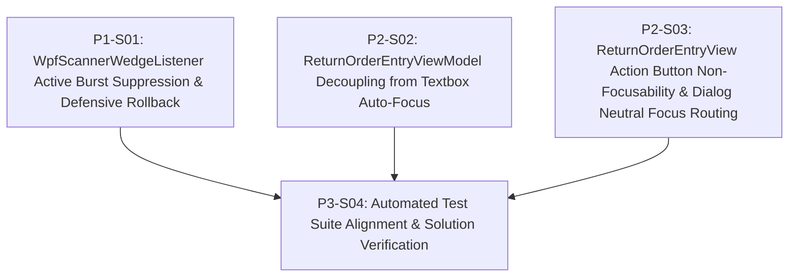

# 1. Objective

Implement the two-pillar defense architecture to cleanly separate USB barcode scanner wedge input from physical keyboard input in the warehouse desktop application (`BtrReturGudang.Wpf`).

Specifically, it realizes the technical solution for defect `BTRG-SCANNER-INPUT-SEPARATION-001` (recorded in [IS004 - BTRG-SCANNER-KEYBOARD-INPUT-SEPARATION-ISSUE.md](file:///d:/Project.Private/btr-platform/docs/issues/IS004%20-%20BTRG-SCANNER-KEYBOARD-INPUT-SEPARATION-ISSUE.md)) by:
1. **Pillar 1 (Service Layer — Active Burst Suppression & Contamination Rollback):** Upgrading `WpfScannerWedgeListener` to selectively suppress `WM_CHAR` messages for characters 2..N whenever inter-keystroke intervals confirm a hardware scan burst ($\le 50\text{ms}$). Providing defense-in-depth against single-character leakage by detecting whether an editable `TextBox` held focus when the scan burst completes (`VK_RETURN`), automatically reverting the single leaked character via `TextBox.Undo()`, clearing focus, and dispatching the clean normalized barcode to `ActiveConsumer.OnBarcodeScanned`.
2. **Pillar 2 (Presentation Layer — Scanner-First Neutral Focus Pattern):** Eliminating premature and aggressive focus hijacking onto quantity textboxes (`TxtQtyBagus`, `TxtQtyRusak`) during initial scans, consecutive item scans, and mode toggles in `ReturnOrderEntryViewModel`. Anchoring UI focus on neutral container `DgvItems` across view loading, line-item commits, and modal dialog dismissals in `ReturnOrderEntryView.xaml.cs`. Stripping focusability (`Focusable="False"`) from action and toolbar buttons (`BtnSearchCustomer`, `BtnAddItem`, `BtnSaveDraft`, `BtnSaveAndUpload`, `BtnReset`, `BtnManualSearch`) in `ReturnOrderEntryView.xaml`, preventing buttons from capturing focus and being accidentally triggered by incoming scan bursts or Enter keystrokes.
3. **Automated Verification:** Updating unit tests in `WpfScannerWedgeListenerTests.cs` and workflow integration tests in `WorkflowIntegrationTests.cs` to align with the neutral focus model and burst suppression/rollback mechanics, ensuring full test pass with zero regressions.

Planning Mode: FEATURE-PLANNING

Referenced artifacts:
- ISSUE: [IS004 - BTRG-SCANNER-KEYBOARD-INPUT-SEPARATION-ISSUE.md](file:///d:/Project.Private/btr-platform/docs/issues/IS004%20-%20BTRG-SCANNER-KEYBOARD-INPUT-SEPARATION-ISSUE.md) (`BTRG-SCANNER-INPUT-SEPARATION-001`)
- FEASIBILITY-ASSESSMENT: [IS004-BTRG-SCANNER-INPUT-SEPARATION-FEASIBILITY-ASSESSMENT.md](file:///d:/Project.Private/btr-platform/docs/issues/IS004-BTRG-SCANNER-INPUT-SEPARATION-FEASIBILITY-ASSESSMENT.md) (`IS004-BTRG-SCANNER-INPUT-SEPARATION`) (Status: `READY-FOR-PLANNING`)
- ARCHITECTURE: [IS004-BTRG-SCANNER-INPUT-SEPARATION-ARCHITECTURE.md](file:///d:/Project.Private/btr-platform/docs/issues/IS004-BTRG-SCANNER-INPUT-SEPARATION-ARCHITECTURE.md) (`IS004-BTRG-SCANNER-INPUT-SEPARATION`)
- Parent / Baseline ARCHITECTURE: [BTR-RETUR-GUDANG-DESKTOP-ARCHITECTURE.md](file:///d:/Project.Private/btr-platform/docs/work/j09-btr-retur-gudang/BTR-RETUR-GUDANG-DESKTOP-ARCHITECTURE.md) (`BTR-RETUR-DESKTOP-001`, updating `TD-005` and refining `TD-011` / `TD-013` for WPF)
- ADR Reference: [ADR-001-desktop-keyboard-wedge-scanning.md](file:///d:/Project.Private/btr-platform/docs/work/barcode-registry/adrs/ADR-001-desktop-keyboard-wedge-scanning.md)

Architecture Applicability: ARCHITECTURE-REQUIRED  
Target system capability architecture is defined and authoritative in [IS004-BTRG-SCANNER-INPUT-SEPARATION-ARCHITECTURE.md](file:///d:/Project.Private/btr-platform/docs/issues/IS004-BTRG-SCANNER-INPUT-SEPARATION-ARCHITECTURE.md).

---

# 2. Planning Scope

The implementation scope is localized to the warehouse desktop application solution `src/j09-btr-retur-gudang`:

1. **Service Layer (`BtrReturGudang.Wpf/Services/WpfScannerWedgeListener.cs`):**
   - Active burst discrimination: selectively mark `WM_CHAR` as handled (`return true`) for characters 2..N when `elapsedSinceLast <= InterKeystrokeTimeoutMs` (50ms).
   - Preserve `WM_KEYDOWN` dispatch for alphanumeric keys to ensure Windows `TranslateMessage` continues feeding `WM_CHAR` into the listener buffer.
   - Suppress `VK_RETURN` on `WM_KEYDOWN` and subsequent translated `\r` / `\n` on `WM_CHAR`.
   - Post-burst contamination rollback & neutral focus: detect if `Keyboard.FocusedElement is TextBox tb && !tb.IsReadOnly`; invoke `tb.Undo()` if `tb.CanUndo` is true, clear keyboard focus (`Keyboard.ClearFocus()`), and dispatch the normalized barcode to `ActiveConsumer.OnBarcodeScanned(normalized)`.

2. **Presentation Layer — ViewModel Orchestration (`BtrReturGudang.Wpf/ViewModels/ReturnOrderEntryViewModel.cs`):**
   - Eliminate automatic `RequestFocusQtyBagus?.Invoke()` from `ApplyActiveProduct()`.
   - Eliminate automatic `RequestFocusQtyBagus?.Invoke()` and `RequestFocusQtyRusak?.Invoke()` from consecutive scan increment logic.
   - Update `SetQuantityMode()` and barcode command mode switching (`CMD:BAGUS`, `CMD:RUSAK`, `$$BAGUS`, `$$RUSAK`) to update the active mode and banner without stealing focus into quantity textboxes.
   - Retain `RequestFocusGrid?.Invoke()` upon `CommitQuantityStripToGrid()` so manual quantity commits return focus to `DgvItems`.

3. **Presentation Layer — View Hardening & Dialog Routing (`BtrReturGudang.Wpf/Views`):**
   - `ReturnOrderEntryView.xaml`: declare `Focusable="False"` on `BtnSearchCustomer`, `BtnAddItem`, `BtnSaveDraft`, `BtnSaveAndUpload`, `BtnReset`, and `BtnManualSearch`.
   - `ReturnOrderEntryView.xaml.cs`: in `OnLoaded`, default initial focus to `DgvItems` via `FocusGrid()`. In dialog launchers (`CustomerSearchDialogLauncher`, `ManualSearchDialogLauncher`, `QuickRegistrationDialogLauncher`), explicitly invoke `FocusGrid()` upon dialog closure.

4. **Automated Verification (`BtrReturGudang.Wpf.Tests`):**
   - Update `WpfScannerWedgeListenerTests.cs`: assert character 2..N burst suppression (`handled == true`) and character 1 pass-through (`handled == false`).
   - Add unit test verifying `TextBox.Undo()` rollback and focus clearing upon scan completion when a `TextBox` holds focus.
   - Update `WorkflowIntegrationTests.cs`: align focus assertions with neutral focus architecture (0 textbox auto-focuses on mode toggles; consecutive scanning preserves neutral focus; dialog return restores focus to grid).
   - Solution-wide test run: verify `dotnet test src/j09-btr-retur-gudang/BtrReturGudang.sln` compiles and passes all test suites across all projects.

### Out of Scope:
- Scanner hardware reconfiguration (standard USB HID wedge remains unchanged per ADR-001).
- Communication protocol changes (no OPOS, POS for .NET, or Virtual COM port drivers).
- Database schema migrations or table modifications (no changes to SQL Server or SQLite).
- Cloud API synchronization contracts (`j06-pkl-btrade-api`).
- Domain logic or core entity changes (`BtrReturGudang.Domain`).

---

# 3. Dependencies

All changes target the warehouse desktop solution repository: `src/j09-btr-retur-gudang`.

### Dependency Rules:
- `Depends On` declares implementation prerequisites between slices.
- Dependencies reference Slice IDs only.
- Dependency satisfaction requires the referenced slice to have implementation status `IMPLEMENTED`.
- Dependency satisfaction does not require review status `GO`.
- Dependencies represent real technical implementation prerequisites.

### Execution Dependency Graph:



### Parallel Opportunities:
- `P1-S01` (Wedge Listener Service), `P2-S02` (ViewModel focus decoupling), and `P2-S03` (View XAML/code-behind focus hardening) have no implementation prerequisites on each other and can execute concurrently.
- `P3-S04` (Automated verification) executes after `P1-S01`, `P2-S02`, and `P2-S03` are all `IMPLEMENTED`, providing comprehensive verification across the service and presentation layers.

---

# 4. Progress Summary

Plan status: NOT-STARTED  
Execution Approval: APPROVED

| Phase | Implementation Status | Review Status | Progress |
| :--- | :--- | :--- | :--- |
| P1 - Service Layer: Wedge Listener Burst Suppression & Rollback | NOT-STARTED | NOT-REVIEWED | 0/1 |
| P2 - Presentation Layer: Scanner-First Neutral Focus Orchestration | NOT-STARTED | NOT-REVIEWED | 0/2 |
| P3 - Automated Verification: Test Suite Alignment & Solution Verification | NOT-STARTED | NOT-REVIEWED | 0/1 |

---

# 5. Phases

## P1 - Service Layer: Wedge Listener Burst Suppression & Rollback

Implementation Status: NOT-STARTED  
Review Status: NOT-REVIEWED

---

### P1-S01

Title: `WpfScannerWedgeListener` Active Burst Suppression & Defensive Rollback

Implementation Status: NOT-STARTED  
Review Status: NOT-REVIEWED  

Objective:  
Enhance `WpfScannerWedgeListener.cs` to actively suppress `WM_CHAR` messages for characters 2..N during high-speed scanner bursts ($\le 50\text{ms}$), suppress terminating `VK_RETURN` on `WM_KEYDOWN` and `WM_CHAR`, and perform defensive `TextBox.Undo()` rollback and focus neutralization if an editable `TextBox` was focused when the scan completed.

Depends On: None  

Repository: `src/j09-btr-retur-gudang`  

Target Files:
- `src/j09-btr-retur-gudang/BtrReturGudang.Wpf/Services/WpfScannerWedgeListener.cs` (MODIFY)

Implementation Details:
1. In `WpfScannerWedgeListener.cs`:
   - Import `System.Windows.Input` and `System.Windows.Controls`.
   - In `ProcessMessage(ref MSG msg)`:
     - In `msg.message == WM_CHAR`:
       - Handle Enter character (`\r` / `\n`):
         - Preserve existing suppression logic when `_suppressNextEnterChar` is true.
         - If `_buffer.Length >= MinBarcodeLength && elapsedSinceLast <= InterKeystrokeTimeoutMs`: execute defensive rollback helper, flush buffer, dispatch barcode, and return `true`.
       - For printable characters (`c >= 32`):
         - Check if this keystroke is part of an ongoing high-speed burst:
           ```csharp
           bool isBurst = _buffer.Length >= 1 && elapsedSinceLast <= InterKeystrokeTimeoutMs;
           ```
         - If `elapsedSinceLast > InterKeystrokeTimeoutMs`:
           - Flush buffer (human typing pass-through).
         - Append `c` to `_buffer`.
         - Update `_lastKeystrokeTimestamp = now;`.
         - If `isBurst`:
           - Return `true` (handled/suppressed) — blocks characters 2..N from being injected into active UI controls while allowing `_buffer` to capture the complete barcode.
         - Else (character 1):
           - Return `false` (pass-through) — preserves normal human typing responsiveness for single keystrokes.
     - In `msg.message == WM_KEYDOWN`:
       - Preserve `IsNavigationOrFunctionKey` check flushing buffer and returning `false`.
       - For alphanumeric keys ($0..9, A..Z$): do **not** suppress (`return false`), ensuring Windows `TranslateMessage` generates corresponding `WM_CHAR` messages for the listener.
       - For `vk == VK_RETURN`:
         - When `_buffer.Length >= MinBarcodeLength && elapsedSinceLast <= InterKeystrokeTimeoutMs`:
           - Execute defensive rollback helper:
             ```csharp
             RollbackFocusedTextBoxContamination();
             ```
           - Extract raw barcode and normalized barcode per VO-01.
           - Flush buffer, reset timestamp, set `_suppressNextEnterChar = true`.
           - Dispatch barcode to subscribers and `ActiveConsumer`.
           - Return `true` (handled/suppressed) to prevent Enter from triggering default buttons or inserting line breaks.
2. Implement private helper `RollbackFocusedTextBoxContamination()`:
   - Check if active keyboard focus target is an editable `TextBox`:
     ```csharp
     if (Keyboard.FocusedElement is TextBox tb && !tb.IsReadOnly)
     {
         if (tb.CanUndo)
         {
             tb.Undo();
         }
         Keyboard.ClearFocus();
     }
     ```
   - Defensive exception handling: wrap in try-catch to ensure failure in focus manipulation never prevents barcode dispatch.

Completion Criteria:
- `ProcessMessage` returns `true` (suppressed) for `WM_CHAR` on characters 2..N during intervals $\le 50\text{ms}$.
- `ProcessMessage` returns `false` (pass-through) for character 1 and for typing with intervals $> 50\text{ms}$.
- `ProcessMessage` returns `true` for `VK_RETURN` upon burst completion, suppressing Enter from active controls.
- When an editable `TextBox` holds focus upon burst completion, `tb.Undo()` is invoked and `Keyboard.ClearFocus()` is called before barcode dispatch.
- `BtrReturGudang.Wpf` compiles cleanly without warnings or errors.

---

## P2 - Presentation Layer: Scanner-First Neutral Focus Orchestration

Implementation Status: NOT-STARTED  
Review Status: NOT-REVIEWED

---

### P2-S02

Title: `ReturnOrderEntryViewModel` Decoupling from Textbox Auto-Focus

Implementation Status: NOT-STARTED  
Review Status: NOT-REVIEWED  

Objective:  
Remove all automatic `RequestFocusQtyBagus` and `RequestFocusQtyRusak` invocations across item scan processing, consecutive scan incrementing, and mode switches in `ReturnOrderEntryViewModel.cs`, keeping focus neutral on `DgvItems` during warehouse intake scanning.

Depends On: None  

Repository: `src/j09-btr-retur-gudang`  

Target Files:
- `src/j09-btr-retur-gudang/BtrReturGudang.Wpf/ViewModels/ReturnOrderEntryViewModel.cs` (MODIFY)

Implementation Details:
1. In `ReturnOrderEntryViewModel.cs`:
   - In `ApplyActiveProduct()`:
     - Remove `RequestFocusQtyBagus?.Invoke();` when `ActiveQuantityMode == QuantityEntryMode.Bagus`.
     - Remove `RequestFocusQtyRusak?.Invoke();` when `ActiveQuantityMode == QuantityEntryMode.Rusak`.
     - Focus remains anchored on `DgvItems` / neutral state.
   - In consecutive scan increment logic (inside `OnBarcodeScanned` when barcode matches `_currentScanResult`):
     - Remove `RequestFocusQtyBagus?.Invoke();` on Bagus quantity increment.
     - Remove `RequestFocusQtyRusak?.Invoke();` on Rusak quantity increment.
     - Quantities increment fluidly (`QtyBagus++` or `QtyRusak++`), `BannerStatus` updates with new count, and audio plays success beep without moving focus.
   - In `SetQuantityMode(QuantityEntryMode mode)`:
     - Remove `RequestFocusQtyBagus?.Invoke();` and `RequestFocusQtyRusak?.Invoke();`.
     - Mode switches update `BannerStatus` and mode indicator pill without shifting focus.
   - In barcode command mode switching (`CMD:BAGUS`, `CMD:RUSAK`, `$$BAGUS`, `$$RUSAK`):
     - Remove `RequestFocusQtyBagus?.Invoke();` and `RequestFocusQtyRusak?.Invoke();`.
   - In `CommitQuantityStripToGrid()`:
     - Retain `RequestFocusGrid?.Invoke();` to ensure manual quantity overrides (where an operator explicitly clicked a textbox and hit Enter) automatically return focus to the neutral grid.

Completion Criteria:
- Scanning an item does not trigger `RequestFocusQtyBagus` or `RequestFocusQtyRusak`.
- Scanning an item consecutively increments quantity, updates the Product Banner, and beeps without triggering `RequestFocusQtyBagus` or `RequestFocusQtyRusak`.
- Switching quantity modes (via `ToggleQuantityModeCommand` or barcode commands) updates mode state without stealing focus.
- `CommitQuantityStripToGrid()` fires `RequestFocusGrid` to restore focus to `DgvItems`.
- `BtrReturGudang.Wpf` compiles cleanly.

---

### P2-S03

Title: `ReturnOrderEntryView` Action Button Non-Focusability & Dialog Neutral Focus Routing

Implementation Status: NOT-STARTED  
Review Status: NOT-REVIEWED  

Objective:  
Harden UI focusability in `ReturnOrderEntryView.xaml` by marking action and toolbar buttons as `Focusable="False"`, and update `ReturnOrderEntryView.xaml.cs` to default initial focus to `DgvItems` on load and ensure all modal dialog completion callbacks restore focus to `DgvItems`.

Depends On: None  

Repository: `src/j09-btr-retur-gudang`  

Target Files:
- `src/j09-btr-retur-gudang/BtrReturGudang.Wpf/Views/ReturnOrderEntryView.xaml` (MODIFY)
- `src/j09-btr-retur-gudang/BtrReturGudang.Wpf/Views/ReturnOrderEntryView.xaml.cs` (MODIFY)

Implementation Details:
1. In `ReturnOrderEntryView.xaml`:
   - Set `Focusable="False"` on:
     - `BtnSearchCustomer` (`x:Name="BtnSearchCustomer"`, Content: `🔍 Cari [F8]`)
     - `BtnAddItem` (`x:Name="BtnAddItem"`, Content: `+ Tambah [Enter]`)
     - `BtnSaveDraft` (`x:Name="BtnSaveDraft"`, Content: `[F9]  Simpan Draft`)
     - `BtnSaveAndUpload` (`x:Name="BtnSaveAndUpload"`, Content: `[F10]  Simpan & Upload`)
     - `BtnReset` (`x:Name="BtnReset"`, Content: `[Esc]  Reset Form`)
     - `BtnManualSearch` (`x:Name="BtnManualSearch"`, Content: `[F2]  Cari Barang`)
   - Preserve all existing styles, templates, grids, bindings, and commands.
2. In `ReturnOrderEntryView.xaml.cs`:
   - In `OnLoaded(object sender, RoutedEventArgs e)`:
     - Replace existing logic with `FocusGrid();` so view activation unconditionally anchors keyboard focus on `DgvItems`.
   - In `CustomerSearchDialogLauncher`:
     - Wrap dialog invocation so that `FocusGrid()` is called before returning the result (regardless of whether the dialog returned true or false).
   - In `ManualSearchDialogLauncher`:
     - Wrap dialog invocation so that `FocusGrid()` is called before returning the result.
   - In `QuickRegistrationDialogLauncher`:
     - Wrap dialog invocation so that `FocusGrid()` is called before returning the result.
   - Preserve global keyboard shortcuts (`F2`, `F8`) and quantity input shortcuts (`Enter`).

Completion Criteria:
- All action and toolbar buttons have `Focusable="False"` in XAML and cannot receive keyboard focus via Tab or mouse clicks.
- Keyboard shortcuts (`F2`, `F8`, `F9`, `F10`, `Esc`, `Enter`) continue to function globally without button focus.
- On view load, keyboard focus is placed on `DgvItems`.
- Closing `ManualCustomerSearchDialog`, `ManualItemSearchDialog`, or `QuickBarcodeRegistrationDialog` unconditionally restores keyboard focus to `DgvItems`.
- `BtrReturGudang.Wpf` compiles cleanly.

---

## P3 - Automated Verification: Test Suite Alignment & Solution Verification

Implementation Status: NOT-STARTED  
Review Status: NOT-REVIEWED

---

### P3-S04

Title: Automated Test Suite Alignment & Full Solution Verification

Implementation Status: NOT-STARTED  
Review Status: NOT-REVIEWED  

Objective:  
Update and extend unit and integration tests in `BtrReturGudang.Wpf.Tests` to verify active burst suppression, defensive character rollback, non-focusable action buttons, and scanner-first neutral focus behavior, and execute full solution tests ensuring 100% build and test pass.

Depends On: P1-S01, P2-S02, P2-S03  

Repository: `src/j09-btr-retur-gudang`  

Target Files:
- `src/j09-btr-retur-gudang/BtrReturGudang.Wpf.Tests/WpfScannerWedgeListenerTests.cs` (MODIFY)
- `src/j09-btr-retur-gudang/BtrReturGudang.Wpf.Tests/WorkflowIntegrationTests.cs` (MODIFY)

Implementation Details:
1. In `WpfScannerWedgeListenerTests.cs`:
   - In `ScannerWedge_FastBurst_InterceptsAndSuppressesEnter`:
     - Update character assertion loop:
       ```csharp
       for (int i = 0; i < barcode.Length; i++)
       {
           mockTime += 10;
           var wmChar = CreateKeyMessage(WpfScannerWedgeListener.WM_CHAR, barcode[i]);
           bool handledChar = listener.ProcessMessage(ref wmChar);
           if (i == 0)
           {
               Assert.False(handledChar); // Char 1 passes through
           }
           else
           {
               Assert.True(handledChar);  // Chars 2..N are suppressed during burst
           }
       }
       ```
   - Add unit test `ScannerWedge_FastBurst_WhenTextBoxFocused_PerformsUndoAndClearsFocus`:
     - Create an editable `TextBox` with text `"ABC"`.
     - Append a character to simulate character 1 passthrough (`"ABC8"`).
     - Verify that upon `VK_RETURN` burst completion, `tb.Undo()` is invoked (restoring text to `"ABC"`) and keyboard focus is cleared.
   - Add unit test `ScannerWedge_SlowTyping_DoesNotSuppressCharactersOrEnter`:
     - Verify slow typing ($> 50\text{ms}$) leaves `handled == false` for all characters and Enter.
2. In `WorkflowIntegrationTests.cs`:
   - In `BarcodeCommand_ModeSwitching_UpdatesModeAndBanner`:
     - Update focus assertions: verify `focusRusakCount == 0` and `focusBagusCount == 0`, confirming that mode switches no longer steal focus into quantity textboxes.
   - In `ToggleQuantityModeCommand_TogglesBetweenBagusAndRusak`:
     - Update focus assertions: verify `focusRusakCount == 0` and `focusBagusCount == 0`.
   - Add integration test `BarcodeScan_ConsecutiveScan_IncrementsQuantityWithoutFocusingQuantityInputs`:
     - Register an item and simulate scanning it twice consecutively.
     - Assert quantity increments to 2, success beep plays, and neither `RequestFocusQtyBagus` nor `RequestFocusQtyRusak` is fired.
   - Add integration test `CustomerSearch_OnDialogClosed_RestoresFocusToGrid`:
     - Simulate customer search launcher completion and assert focus returns to `DgvItems`.
3. Execute solution-wide test suite:
   - Run `dotnet test src/j09-btr-retur-gudang/BtrReturGudang.sln`.
   - Verify that all active test projects (`Domain.Tests`, `AppTier.Tests`, `Infrastructure.Tests`, `Wpf.Tests`) pass with 0 failures.

Completion Criteria:
- All unit tests in `WpfScannerWedgeListenerTests.cs` pass.
- All integration tests in `WorkflowIntegrationTests.cs` pass.
- `dotnet test src/j09-btr-retur-gudang/BtrReturGudang.sln` completes with 0 errors and 0 failed tests.

---

# 6. Change Log

- 2026-11-12: Initial implementation plan created by `ica-architect` based on approved architecture `IS004-BTRG-SCANNER-INPUT-SEPARATION-ARCHITECTURE.md` and feasibility assessment `IS004-BTRG-SCANNER-INPUT-SEPARATION-FEASIBILITY-ASSESSMENT.md`. Granted `Execution Approval: APPROVED` for execution. Structure is finalized and immutable.
