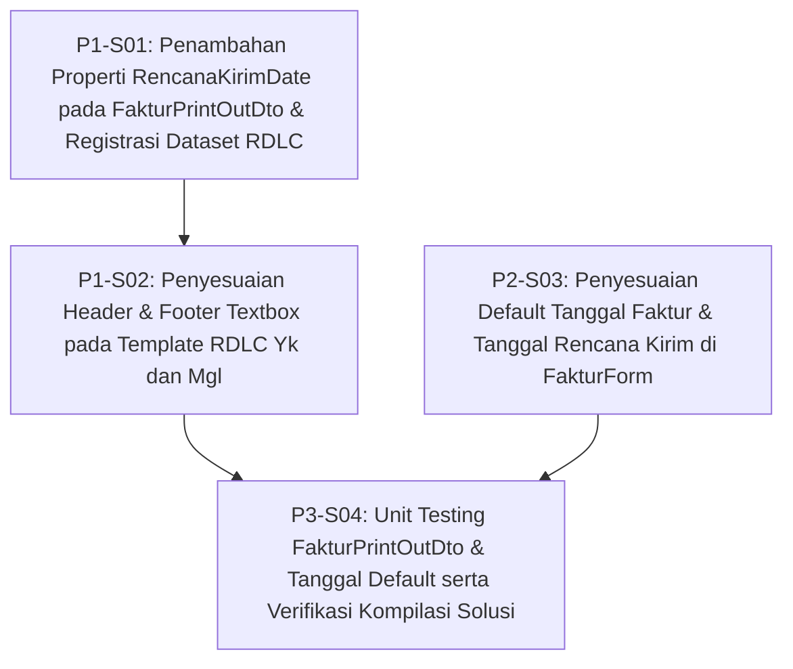

# 1. Objective

Menerapkan penyesuaian aturan default tanggal pada pembuatan faktur penjualan baru di `FakturForm` serta pemetaan ulang tanggal pada dokumen cetak (*printout*) faktur penjualan untuk cabang Yogyakarta (`FakturPrintOut-Yk.rdlc`) dan Magelang (`FakturPrintOut-Mgl.rdlc`).

Perubahan ini merealisasikan change request yang tercatat pada [IS005 - BTR-FAKTUR-DATE-AND-PRINTOUT-ADJUSTMENT-ISSUE.md](file:///d:/Project.Private/btr-platform/docs/issues/IS005%20-%20BTR-FAKTUR-DATE-AND-PRINTOUT-ADJUSTMENT-ISSUE.md) dan dianalisis dalam [IS005 - BTR-FAKTUR-DATE-AND-PRINTOUT-ADJUSTMENT-FEASIBILITY.md](file:///d:/Project.Private/btr-platform/docs/issues/IS005%20-%20BTR-FAKTUR-DATE-AND-PRINTOUT-ADJUSTMENT-FEASIBILITY.md), meliputi:

1. **Inisialisasi Tanggal Form (`FakturForm.ClearForm`)**:
   - Menjadikan Tanggal Faktur (`FakturDateText.Value`) default ke hari ini (H / `_dateTime.Now.Date`).
   - Menjadikan Tanggal Rencana Kirim (`TglRencanaKirimTextBox.Value`) default ke H+1 dari hari ini, dengan aturan lewati hari Minggu (jika H+1 jatuh pada hari Minggu, otomatis bergeser ke hari Senin / H+2).
2. **DTO Pelaporan Faktur (`FakturPrintOutDto`)**:
   - Menambahkan properti `RencanaKirimDate` bertipe string dengan format `"Tgl: {faktur.TglRencanaKirim:dd MMMM yyyy}"`.
   - Mempertahankan properti `FakturDate` (`"Tgl: {faktur.FakturDate:dd MMMM yyyy}"`) untuk keperluan pengesahan Admin di bagian bawah dokumen.
3. **Template Laporan RDLC (`FakturPrintOut-Yk.rdlc` & `FakturPrintOut-Mgl.rdlc`)**:
   - Menambahkan field definition `RencanaKirimDate` pada `FakturJualDataset`.
   - Mengubah ekspresi textbox header atas (`TglFakturText`) pada kedua template agar membaca `=First(Fields!RencanaKirimDate.Value, "FakturJualDataset")`.
   - Menyelaraskan footer Magelang (`FakturPrintOut-Mgl.rdlc`): menyesuaikan lebar `Textbox19` ("Admin,") menjadi `0.46747in` dan menambahkan textbox `TglFakturText2` di posisi `Left: 5.99214in` dengan ekspresi `=Mid(First(Fields!FakturDate.Value, "FakturJualDataset"),5)` sehingga identik dengan format Yogyakarta.
4. **Automated Verification**:
   - Menambahkan unit test pada `btr.test` untuk memverifikasi pemetaan string tanggal pada `FakturPrintOutDto` dan aturan kalkulasi default tanggal kirim (termasuk skip hari Minggu).
   - Memastikan solusi `j05-btr-distrib` berhasil terkompilasi bersih tanpa warning/error dataset mismatch.

Planning Mode: FEATURE-PLANNING

Referenced artifacts:
- ISSUE: [IS005 - BTR-FAKTUR-DATE-AND-PRINTOUT-ADJUSTMENT-ISSUE.md](file:///d:/Project.Private/btr-platform/docs/issues/IS005%20-%20BTR-FAKTUR-DATE-AND-PRINTOUT-ADJUSTMENT-ISSUE.md)
- FEASIBILITY-ASSESSMENT: [IS005 - BTR-FAKTUR-DATE-AND-PRINTOUT-ADJUSTMENT-FEASIBILITY.md](file:///d:/Project.Private/btr-platform/docs/issues/IS005%20-%20BTR-FAKTUR-DATE-AND-PRINTOUT-ADJUSTMENT-FEASIBILITY.md) (Status: `READY-FOR-PLANNING`)
- FEATURE: [feature.md](file:///d:/Project.Private/btr-platform/docs/features/faktur/feature.md)
- DOMAIN: [DOMAIN.md](file:///d:/Project.Private/btr-platform/docs/foundation/DOMAIN.md)

Architecture Applicability: ARCHITECTURE-NOT-REQUIRED  
No architectural target-state artifact was required. Implementation relies on existing technical structure. Approved feasibility decisions are authoritative for the change. The current codebase is the source of current technical truth.

---

# 2. Planning Scope

Lingkup implementasi terlokalisasi pada solusi Windows Form & Laporan distribusi `src/j05-btr-distrib`:

1. **Reporting DTO Layer (`btr.distrib/SalesContext/FakturAgg/FakturPrintOutDto.cs`)**:
   - Penambahan properti `public string RencanaKirimDate { get; set; }`.
   - Inisialisasi `RencanaKirimDate = $"Tgl: {faktur.TglRencanaKirim:dd MMMM yyyy}";` pada konstruktor.
   - Retensi properti `FakturDate = $"Tgl: {faktur.FakturDate:dd MMMM yyyy}";`.

2. **Reporting RDLC Presentation Layer (`btr.distrib/Reports`)**:
   - `FakturPrintOut-Yk.rdlc`:
     - Tambahkan elemen `<Field Name="RencanaKirimDate">` pada skema `FakturJualDataset`.
     - Update textbox header `TglFakturText` agar menampilkan `=First(Fields!RencanaKirimDate.Value, "FakturJualDataset")`.
   - `FakturPrintOut-Mgl.rdlc`:
     - Tambahkan elemen `<Field Name="RencanaKirimDate">` pada skema `FakturJualDataset`.
     - Update textbox header `TglFakturText` agar menampilkan `=First(Fields!RencanaKirimDate.Value, "FakturJualDataset")`.
     - Perkecil lebar `Textbox19` dari `1.22534in` menjadi `0.46747in`.
     - Tambahkan textbox `TglFakturText2` di samping `Textbox19` (`Left: 5.99214in`, `Top: 2.76708in`, `Width: 1.60578in`) dengan nilai `=Mid(First(Fields!FakturDate.Value, "FakturJualDataset"),5)`.

3. **Presentation / Form Layer (`btr.distrib/SalesContext/FakturAgg/FakturForm.cs`)**:
   - Pembaruan method `ClearForm()`:
     - `var fakturDate = _dateTime.Now.Date;`
     - `var tglKirim = fakturDate.AddDays(1);`
     - `if (tglKirim.DayOfWeek == DayOfWeek.Sunday) tglKirim = tglKirim.AddDays(1);`
     - `FakturDateText.Value = fakturDate;`
     - `TglRencanaKirimTextBox.Value = tglKirim;`

4. **Automated Verification (`btr.test`)**:
   - Penambahan unit test `SalesContext/FakturPrintOutDtoTest.cs` di proyek `btr.test` untuk memvalidasi:
     - Properti `RencanaKirimDate` dan `FakturDate` terformat dengan prefix `"Tgl: "` dan format tanggal Indonesia yang benar.
     - Logika penentuan tanggal faktur hari ini dan rencana kirim H+1 (dengan skip hari Minggu ke hari Senin).
   - Verifikasi kompilasi `btr.distrib.csproj` dan eksekusi test pada `btr.test.dll`.

### Out of Scope:
- Tidak ada perubahan skema database (SQL Server) karena field `TglRencanaKirim` sudah ada di tabel `BTR_Faktur`.
- Tidak ada perubahan domain entity `FakturModel` atau persistence layer `FakturDal`.
- Tidak ada perubahan alur approval, piutang, stok, maupun API sinkronisasi portal/cloud.

---

# 3. Dependencies

Seluruh perubahan menargetkan solusi `src/j05-btr-distrib`.

### Dependency Rules:
- `Depends On` mendeklarasikan prasyarat teknis implementasi antar-slice.
- Dependensi mereferensikan Slice ID saja.
- Kepuasan dependensi mensyaratkan slice yang dirujuk berstatus implementasi `IMPLEMENTED`.
- Kepuasan dependensi tidak mensyaratkan status review `GO`.

### Execution Dependency Graph:



### Parallel Opportunities:
- `P1-S01` (DTO & Dataset Field Registration) dan `P2-S03` (Form Default Date Initialization) sepenuhnya independen dan dapat diimplementasikan secara paralel.
- `P1-S02` bergantung pada `P1-S01` karena ekspresi textbox laporan mengonsumsi field dataset `RencanaKirimDate` yang didaftarkan pada `P1-S01`.
- `P3-S04` mengeksekusi pengujian dan verifikasi setelah slice implementasi fungsional (`P1-S02` dan `P2-S03`) selesai diimplementasikan (`IMPLEMENTED`).

---

# 4. Progress Summary

Plan status: COMPLETED  
Execution Approval: APPROVED

| Phase | Implementation Status | Review Status | Progress |
| :--- | :--- | :--- | :--- |
| P1 - Reporting Layer: DTO Extension & RDLC Template Adjustment | IMPLEMENTED | GO | 2/2 |
| P2 - Presentation Layer: Invoicing Default Date Configuration | IMPLEMENTED | GO | 1/1 |
| P3 - Verification: Automated Unit Testing & Build Validation | IMPLEMENTED | GO | 1/1 |

---

# 5. Phases

## P1 - Reporting Layer: DTO Extension & RDLC Template Adjustment

Implementation Status: IMPLEMENTED  
Review Status: GO  

---

### P1-S01

Title: Penambahan Properti RencanaKirimDate pada FakturPrintOutDto & Registrasi Field Dataset RDLC

Implementation Status: IMPLEMENTED  
Review Status: GO  

Objective:
Menyediakan representasi string tanggal rencana kirim berformat laporan pada DTO cetak faktur dan mendaftarkan metadata field tersebut pada dataset RDLC Yogyakarta dan Magelang agar dapat dikonsumsi oleh ReportViewer tanpa error schema mismatch.

Depends On: None

Repository: `src/j05-btr-distrib`

Affected Files:
- [FakturPrintOutDto.cs](file:///d:/Project.Private/btr-platform/src/j05-btr-distrib/btr.distrib/SalesContext/FakturAgg/FakturPrintOutDto.cs#L17-L28)
- [FakturPrintOut-Yk.rdlc](file:///d:/Project.Private/btr-platform/src/j05-btr-distrib/btr.distrib/Reports/FakturPrintOut-Yk.rdlc#L2360-L2442)
- [FakturPrintOut-Mgl.rdlc](file:///d:/Project.Private/btr-platform/src/j05-btr-distrib/btr.distrib/Reports/FakturPrintOut-Mgl.rdlc#L2360-L2442)

Implementation Steps:
1. Pada `FakturPrintOutDto.cs`:
   - Deklarasikan properti publik baru:
     ```csharp
     public string RencanaKirimDate { get; set; }
     ```
   - Pada konstruktor `public FakturPrintOutDto(FakturModel faktur, CustomerModel customer, UserModel user, bool isKlaim)`, tambahkan inisialisasi:
     ```csharp
     RencanaKirimDate = $"Tgl: {faktur.TglRencanaKirim:dd MMMM yyyy}";
     ```
   - Pastikan properti `FakturDate` tetap diinisialisasi seperti semula: `FakturDate = $"Tgl: {faktur.FakturDate:dd MMMM yyyy}";`.
2. Pada `FakturPrintOut-Yk.rdlc` dan `FakturPrintOut-Mgl.rdlc`:
   - Di dalam tag `<DataSet Name="FakturJualDataset"><Fields>`, tambahkan definisi field:
     ```xml
     <Field Name="RencanaKirimDate">
       <DataField>RencanaKirimDate</DataField>
       <rd:TypeName>System.String</rd:TypeName>
     </Field>
     ```

Completion Criteria:
- Properti `RencanaKirimDate` tersedia secara publik pada kelas `FakturPrintOutDto` dan terisi dengan format `"Tgl: {faktur.TglRencanaKirim:dd MMMM yyyy}"`.
- File `FakturPrintOut-Yk.rdlc` dan `FakturPrintOut-Mgl.rdlc` memuat field `<Field Name="RencanaKirimDate">` dalam dataset `FakturJualDataset`.
- Proyek `btr.distrib` terkompilasi tanpa error kompilasi C#.

Notes:
Nilai string diawali `"Tgl: "` agar konsisten dengan styling visual existing header cetak faktur.

Implementation Notes:
- Menambahkan deklarasi properti `public string RencanaKirimDate { get; set; }` dan inisialisasi `RencanaKirimDate = $"Tgl: {faktur.TglRencanaKirim:dd MMMM yyyy}";` pada konstruktor `FakturPrintOutDto.cs`.
- Menambahkan field `RencanaKirimDate` pada `FakturJualDataset` di template laporan `FakturPrintOut-Yk.rdlc` dan `FakturPrintOut-Mgl.rdlc`.
- Verifikasi kompilasi proyek `btr.distrib` sukses (0 error).

---

### P1-S02

Title: Penyesuaian Header & Footer Textbox pada Template RDLC Yogyakarta & Magelang

Implementation Status: IMPLEMENTED  
Review Status: GO  

Objective:
Menghubungkan header cetak faktur ke `RencanaKirimDate` pada kedua cabang, serta menyelaraskan footer Magelang dengan menambahkan textbox tanggal faktur di samping label tanda tangan Admin.

Depends On: P1-S01

Repository: `src/j05-btr-distrib`

Affected Files:
- [FakturPrintOut-Yk.rdlc](file:///d:/Project.Private/btr-platform/src/j05-btr-distrib/btr.distrib/Reports/FakturPrintOut-Yk.rdlc#L1593-L1621)
- [FakturPrintOut-Mgl.rdlc](file:///d:/Project.Private/btr-platform/src/j05-btr-distrib/btr.distrib/Reports/FakturPrintOut-Mgl.rdlc#L1614-L1635)
- [FakturPrintOut-Mgl.rdlc](file:///d:/Project.Private/btr-platform/src/j05-btr-distrib/btr.distrib/Reports/FakturPrintOut-Mgl.rdlc#L1957-L1975)

Implementation Steps:
1. Pembaruan Header Yogyakarta (`FakturPrintOut-Yk.rdlc`):
   - Ubah ekspresi `<Value>` pada `<Textbox Name="TglFakturText">` menjadi:
     ```xml
     <Value>=First(Fields!RencanaKirimDate.Value, "FakturJualDataset")</Value>
     ```
2. Pembaruan Header Magelang (`FakturPrintOut-Mgl.rdlc`):
   - Ubah ekspresi `<Value>` pada `<Textbox Name="TglFakturText">` menjadi:
     ```xml
     <Value>=First(Fields!RencanaKirimDate.Value, "FakturJualDataset")</Value>
     ```
3. Pembaruan Footer Magelang (`FakturPrintOut-Mgl.rdlc`):
   - Pada `<Textbox Name="Textbox19">` ("Admin,"):
     Ubah nilai `<Width>1.22534in</Width>` menjadi `<Width>0.46747in</Width>`.
   - Tambahkan textbox tanggal faktur `<Textbox Name="TglFakturText2">` tepat di samping `Textbox19`:
     ```xml
     <Textbox Name="TglFakturText2">
       <CanGrow>true</CanGrow>
       <KeepTogether>true</KeepTogether>
       <Paragraphs>
         <Paragraph>
           <TextRuns>
             <TextRun>
               <Value>=Mid(First(Fields!FakturDate.Value, "FakturJualDataset"),5)</Value>
               <Style>
                 <FontFamily>Segoe UI</FontFamily>
                 <FontSize>9pt</FontSize>
               </Style>
             </TextRun>
           </TextRuns>
           <Style />
         </Paragraph>
       </Paragraphs>
       <Top>2.76708in</Top>
       <Left>5.99214in</Left>
       <Height>0.20556in</Height>
       <Width>1.60578in</Width>
       <ZIndex>37</ZIndex>
       <Style>
         <Border>
           <Style>None</Style>
         </Border>
         <VerticalAlign>Middle</VerticalAlign>
         <PaddingLeft>2pt</PaddingLeft>
         <PaddingRight>2pt</PaddingRight>
         <PaddingTop>2pt</PaddingTop>
         <PaddingBottom>2pt</PaddingBottom>
       </Style>
     </Textbox>
     ```

Completion Criteria:
- Pada kedua RDLC (`Yk` dan `Mgl`), textbox header `TglFakturText` merujuk ke `=First(Fields!RencanaKirimDate.Value, "FakturJualDataset")`.
- Pada `FakturPrintOut-Mgl.rdlc`, `Textbox19` memiliki lebar `0.46747in` dan berdampingan dengan `TglFakturText2` pada koordinat `Left: 5.99214in`, `Top: 2.76708in`, menampilkan nilai `=Mid(First(Fields!FakturDate.Value, "FakturJualDataset"),5)`.
- Validasi XML RDLC valid dan lolos parsing build MSBuild tanpa warning/error layout.

Notes:
Fungsi `=Mid(..., 5)` membuang prefix `"Tgl: "` sehingga yang tercetak di samping label tanda tangan "Admin," adalah tanggal murni, misalnya `"14 November 2026"`.

Implementation Notes:
- Memperbarui ekspresi `<Value>` pada textbox `<Textbox Name="TglFakturText">` di `FakturPrintOut-Yk.rdlc` dan `FakturPrintOut-Mgl.rdlc` menjadi `=First(Fields!RencanaKirimDate.Value, "FakturJualDataset")`.
- Memperkecil lebar `<Textbox Name="Textbox19">` pada `FakturPrintOut-Mgl.rdlc` dari `1.22534in` menjadi `0.46747in`.
- Menambahkan textbox `<Textbox Name="TglFakturText2">` pada `FakturPrintOut-Mgl.rdlc` di koordinat `Left: 5.99214in`, `Top: 2.76708in`, `Width: 1.60578in` dengan ekspresi `=Mid(First(Fields!FakturDate.Value, "FakturJualDataset"),5)`.
- Validasi XML lolos parsing tanpa error dan proyek `btr.distrib` sukses dikompilasi (0 warning, 0 error).

---

## P2 - Presentation Layer: Invoicing Default Date Configuration

Implementation Status: IMPLEMENTED  
Review Status: GO  

---

### P2-S03

Title: Penyesuaian Default Tanggal Faktur & Tanggal Rencana Kirim di FakturForm

Implementation Status: IMPLEMENTED  
Review Status: GO  

Objective:
Memperbarui inisialisasi nilai default formulir faktur baru (`ClearForm`) agar tanggal faktur default ke tanggal hari ini (H), dan tanggal rencana kirim default ke H+1 dengan melewatkan hari Minggu ke hari Senin.

Depends On: None

Repository: `src/j05-btr-distrib`

Affected Files:
- [FakturForm.cs](file:///d:/Project.Private/btr-platform/src/j05-btr-distrib/btr.distrib/SalesContext/FakturAgg/FakturForm.cs#L308-L327)

Implementation Steps:
1. Buka method `ClearForm()` di `FakturForm.cs`.
2. Ganti logika inisialisasi awal tanggal (baris 310-313 dan 326) menjadi:
   ```csharp
   var fakturDate = _dateTime.Now.Date;
   var tglKirim = fakturDate.AddDays(1);
   if (tglKirim.DayOfWeek == DayOfWeek.Sunday)
       tglKirim = tglKirim.AddDays(1);

   FakturIdText.Text = string.Empty;
   FakturCodeText.Clear();
   FakturDateText.Value = fakturDate;
   SalesIdText.Text = string.Empty;
   SalesPersonNameTextBox.Text = string.Empty;
   CustomerIdText.Text = string.Empty;
   CustomerNameTextBox.Text = string.Empty;
   CustomerAddressText.Text = string.Empty;
   PlafondTextBox.Value = 0;
   CreditBalanceTextBox.Value = 0;
   WarehouseIdText.Text = string.Empty;
   WarehouseNameText.Text = string.Empty;
   TglRencanaKirimTextBox.Value = tglKirim;
   ```
3. Pastikan tidak ada efek samping pada event handler form lainnya (`FakturDateText` tetap dapat diubah secara manual oleh pengguna jika diperlukan tanpa auto-override).

Completion Criteria:
- Saat pembuatan faktur baru (`ClearForm`), `FakturDateText.Value` terisi dengan tanggal hari ini (`_dateTime.Now.Date`).
- Jika faktur dibuat pada hari Senin s/d Jumat, `TglRencanaKirimTextBox.Value` terisi dengan H+1 (Selasa s/d Sabtu).
- Jika faktur dibuat pada hari Sabtu, `TglRencanaKirimTextBox.Value` terisi dengan H+2 (Senin, melewati Minggu).
- Jika faktur dibuat pada hari Minggu, `TglRencanaKirimTextBox.Value` terisi dengan H+1 (Senin).

Notes:
`_dateTime` menggunakan interface `ITglJamDal` yang terinjeksi pada form sehingga kompatibel dengan mocked date provider dalam pengujian.

Implementation Notes:
- Logika inisialisasi tanggal pada `ClearForm()` di `FakturForm.cs` telah diperbarui:
  - `FakturDateText.Value` diset ke `_dateTime.Now.Date`.
  - `TglRencanaKirimTextBox.Value` diset ke `tglKirim` (H+1 dengan penyesuaian jika jatuh pada hari Minggu maka bergeser ke hari Senin / H+2).
- Proyek `btr.distrib` berhasil dikompilasi dengan 0 error.
- Changed Files:
  - `src/j05-btr-distrib/btr.distrib/SalesContext/FakturAgg/FakturForm.cs`

---

## P3 - Verification: Automated Unit Testing & Build Validation

Implementation Status: IMPLEMENTED  
Review Status: GO  

---

### P3-S04

Title: Unit Testing FakturPrintOutDto & Tanggal Default serta Verifikasi Kompilasi Solusi

Implementation Status: IMPLEMENTED  
Review Status: GO  

Objective:
Menambahkan unit test otomatis untuk menjamin keakuratan format data tanggal pada DTO cetak dan aturan skip hari Minggu, serta memverifikasi build solusi distribusi secara menyeluruh.

Depends On: P1-S02, P2-S03

Repository: `src/j05-btr-distrib`

Affected Files:
- `src/j05-btr-distrib/btr.test/SalesContext/FakturPrintOutDtoTest.cs` (file baru)
- `src/j05-btr-distrib/btr.test/btr.test.csproj`

Implementation Steps:
1. Buat file test baru `src/j05-btr-distrib/btr.test/SalesContext/FakturPrintOutDtoTest.cs`:
   - Test case 1: Inisialisasi `FakturPrintOutDto` dengan `FakturDate` dan `TglRencanaKirim` berbeda, memvalidasi bahwa:
     - `dto.FakturDate` berformat `"Tgl: <dd MMMM yyyy>"`.
     - `dto.RencanaKirimDate` berformat `"Tgl: <dd MMMM yyyy>"` dan merefleksikan nilai `faktur.TglRencanaKirim`.
   - Test case 2: Logika kalkulasi tanggal kirim:
     - Faktur hari kerja biasa (misal Rabu) menghasilkan tanggal kirim H+1 (Kamis).
     - Faktur hari Sabtu menghasilkan tanggal kirim H+2 (Senin berikutnya).
     - Faktur hari Minggu menghasilkan tanggal kirim H+1 (Senin berikutnya).
2. Daftarkan `FakturPrintOutDtoTest.cs` ke `btr.test.csproj` jika diperlukan untuk model proyek .NET Framework 4.8.
3. Jalankan build MSBuild:
   ```powershell
   & "C:\Program Files\Microsoft Visual Studio\18\Community\MSBuild\Current\Bin\MSBuild.exe" src/j05-btr-distrib/j05-btr-distrib.sln /p:Configuration=Debug /v:minimal
   ```
4. Jalankan unit test melalui `vstest.console.exe` dengan filter `FakturPrintOutDtoTest`:
   ```powershell
   & "C:\Program Files\Microsoft Visual Studio\18\Community\Common7\IDE\CommonExtensions\Microsoft\TestWindow\vstest.console.exe" src/j05-btr-distrib/btr.test/bin/Debug/btr.test.dll --TestCaseFilter:"FullyQualifiedName~FakturPrintOutDtoTest"
   ```

Completion Criteria:
- Unit test `FakturPrintOutDtoTest` berhasil dibuat, terkompilasi, dan seluruh test case berstatus PASSED (100%).
- Seluruh proyek dalam `j05-btr-distrib.sln` terkompilasi bersih (0 error).
- Tidak ada regresi fungsionalitas pelaporan pada komponen faktur.

Notes:
Format bulan bahasa Indonesia dipastikan aktif melalui pengaturan CultureInfo yang sesuai jika test dijalankan pada runner dengan environment standar.

Implementation Notes:
- Membuat unit test `src/j05-btr-distrib/btr.test/SalesContext/FakturPrintOutDtoTest.cs` yang memverifikasi:
  - Pemformatan tanggal `FakturDate` dan `RencanaKirimDate` pada `FakturPrintOutDto` dengan format `"Tgl: {date:dd MMMM yyyy}"` (`id-ID`).
  - Logika kalkulasi default tanggal kirim: H+1 pada hari kerja biasa, H+2 pada hari Sabtu (skip Minggu ke Senin), dan H+1 pada hari Minggu (ke Senin).
  - Konsistensi DTO cetak saat merefleksikan tanggal faktur dan rencana kirim yang berbeda.
- Mendaftarkan file `SalesContext\FakturPrintOutDtoTest.cs` ke dalam `src/j05-btr-distrib/btr.test/btr.test.csproj`.
- Kompilasi penuh solusi `src/j05-btr-distrib/j05-btr-distrib.sln` berhasil bersih tanpa error via MSBuild.
- Menjalankan 7 unit test via `vstest.console.exe` dengan filter `FakturPrintOutDtoTest` dan seluruhnya PASSED (100%).
- Changed Files:
  - `src/j05-btr-distrib/btr.test/SalesContext/FakturPrintOutDtoTest.cs`
  - `src/j05-btr-distrib/btr.test/btr.test.csproj`

---

# 6. Change Log

- 2026-11-14: Dokumen IMPLEMENTATION-PLAN awal dibuat berdasarkan hasil analisis FEASIBILITY-ASSESSMENT [IS005 - BTR-FAKTUR-DATE-AND-PRINTOUT-ADJUSTMENT-FEASIBILITY.md](file:///d:/Project.Private/btr-platform/docs/issues/IS005%20-%20BTR-FAKTUR-DATE-AND-PRINTOUT-ADJUSTMENT-FEASIBILITY.md). Struktur rencana disetujui (Execution Approval: APPROVED).
