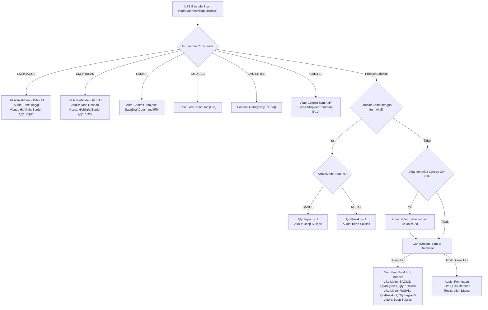

# Implementation Plan: Hands-Free Barcode Scanner Ergonomics & Command Barcodes (WPF)

- **Feature Code:** BTR-RETUR-DESKTOP-001
- **Target Application:** `src/j09-btr-retur-gudang/BtrReturGudang.Wpf`
- **Related Documents:** `docs/features/return-order-desktop/feature.md`, `docs/work/j09-btr-retur-gudang/retur-intake-ergonomics-redesign-plan.md`

## 1. Overview & Context

Dalam operasional gudang retur berkecepatan tinggi *(high-throughput warehouse intake)*, operator gudang memegang scanner barcode USB di satu tangan dan memindahkan fisik produk dengan tangan lainnya. Mengharuskan operator berpindah ke keyboard komputer untuk mengetik kuantitas atau menekan tombol fungsi (seperti F9 untuk simpan atau Esc untuk reset) menimbulkan friksi operasional yang signifikan.

Rancangan ini menambahkan kapabilitas **Hands-Free Barcode Commands**:
1. **Multi-Scan Quantity Accumulation**:
   - Scan pertama produk langsung menginisialisasi kuantitas menjadi 1.
   - Scan berulang pada produk yang sama menginkremen kuantitas (+1) per scan.
2. **Desk Command Barcodes (Barcode Perintah di Meja Operator)**:
   - Barcode Khusus 1: Ganti mode input ke **Qty Bagus** (`CMD:BAGUS`).
   - Barcode Khusus 2: Ganti mode input ke **Qty Rusak** (`CMD:RUSAK`).
   - Operator cukup menscan barcode di meja untuk menentukan klasifikasi barang fisik yang sedang diperiksa.
3. **Desk Command Barcodes untuk Navigasi & Simpan**:
   - `CMD:F9`: Auto-commit item yang sedang aktif ke tabel dan jalankan **[F9] Simpan Draft**.
   - `CMD:ESC`: Jalankan **[Esc] Reset Form**.
   - Perintah pendukung: `CMD:ENTER` (Tambah Item) dan `CMD:F10` (Simpan & Upload).
4. **Continuous Chained Auto-Commit**:
   - Saat operator beralih menscan produk baru, item sebelumnya yang telah memiliki kuantitas (`Qty > 0`) otomatis di-commit ke DataGrid tanpa perlu menekan tombol Tambah secara manual.

---

## 2. Command Barcode Specification (Code 128 / Code 39)

Barcode perintah dicetak pada selembar kertas / stiker di meja operator:

| Desk Label | Barcode Text (Payload) | Alternative Aliases | Deskripsi Aksi |
| :--- | :--- | :--- | :--- |
| **SWITCH: QTY BAGUS** | `CMD:BAGUS` | `CMD:QTY_BAGUS`, `$$BAGUS`, `BTR:QTY-BAGUS` | Mengubah mode kuantitas aktif ke **Qty Bagus**. |
| **SWITCH: QTY RUSAK** | `CMD:RUSAK` | `CMD:QTY_RUSAK`, `$$RUSAK`, `BTR:QTY-RUSAK` | Mengubah mode kuantitas aktif ke **Qty Rusak**. |
| **SIMPAN DRAFT [F9]** | `CMD:F9` | `CMD:SIMPAN`, `CMD:SIMPAN_DRAFT`, `$$F9` | Auto-commit item aktif & simpan draft lokal. |
| **RESET FORM [ESC]** | `CMD:ESC` | `CMD:RESET`, `CMD:RESET_FORM`, `$$ESC` | Batalkan intake & bersihkan form. |
| **TAMBAH ITEM [ENTER]**| `CMD:ENTER` | `CMD:TAMBAH`, `$$ENTER` | Masukkan item aktif ke daftar grid intake. |
| **SIMPAN & UPLOAD [F10]**| `CMD:F10` | `CMD:UPLOAD`, `$$F10` | Simpan draft dan langsung upload cloud. |

---

## 3. Printable Desk Barcode Sheet Template

Operator dapat mencetak kode barcode berikut langsung menggunakan font Code 128 atau barcode generator:

```text
================================================================================
                    BTR RETUR GUDANG - DESK COMMAND BARCODES
================================================================================

  [ 1. MODE: QTY BAGUS ]                    [ 2. MODE: QTY RUSAK ]
     *CMD:BAGUS*                               *CMD:RUSAK*
  (Switch input to Qty Bagus)               (Switch input to Qty Rusak)


  [ 3. SIMPAN DRAFT (F9) ]                  [ 4. RESET FORM (ESC) ]
     *CMD:F9*                                  *CMD:ESC*
  (Auto-commit & Save Draft)                (Cancel & Clear Form)


  [ 5. TAMBAH KE TABEL (ENTER) ]            [ 6. SIMPAN & UPLOAD (F10) ]
     *CMD:ENTER*                               *CMD:F10*
  (Commit current line to grid)             (Save and upload upstream)
================================================================================
```

---

## 4. Architectural Design & Logic Flow



---

## 5. File Changes Breakdown

### 5.1. `BtrReturGudang.Domain`
- **`ValueObjects/BarcodeCommand.cs`**:
  - Value object murni tanpa dependensi pihak ketiga.
  - Parsing case-insensitive dan whitespace-resilient.
  - Memetakan string barcode ke enum `BarcodeCommandType`.

### 5.2. `BtrReturGudang.Wpf`
- **`ViewModels/ReturnOrderEntryViewModel.cs`**:
  - Menambahkan enum `QuantityEntryMode { Bagus, Rusak }`.
  - Properti `ActiveQuantityMode` (default `Bagus`) beserta helper `IsModeBagus`, `IsModeRusak`, `ModeBadgeText`.
  - Refactoring `OnBarcodeScanned(string normalizedBarcode)`:
    - Mengintegrasikan evaluasi `BarcodeCommand`.
    - Mengatur nilai awal kuantitas = 1 saat produk pertama kali discan sesuai mode aktif.
    - Menginkremen kuantitas yang sesuai saat barcode yang sama discan berulang kali.
    - Meng-commit otomatis item sebelumnya saat produk baru discan.
    - Menangani eksekusi perintah F9 dan Esc secara instan.
- **`Views/ReturnOrderEntryView.xaml`**:
  - Menambahkan indikator visual **Pill Badge Mode Kuantitas** (`[● MODE: QTY BAGUS]` hijau / `[● MODE: QTY RUSAK]` merah) pada strip kuantitas.
  - Menghubungkan visual border pada `TxtQtyBagus` dan `TxtQtyRusak` agar aktif menyorot mode yang sedang dipilih.
- **`Views/ReturnOrderEntryView.xaml.cs`**:
  - Menambahkan hook fokus `FocusQtyRusak()` melengkapi `FocusQtyBagus()`.

---

## 6. Verification & Automated Tests

1. `BtrReturGudang.Domain.Tests`:
   - Unit test parsing barcode perintah dan pemisahan tegas dari barcode produk normal.
2. `BtrReturGudang.Wpf.Tests`:
   - Test alur pergantian mode Bagus vs Rusak.
   - Test akumulasi multi-scan: 1 scan = 1, 2 scan = 2, 3 scan = 3.
   - Test item campuran (3 Bagus + 1 Rusak) pada produk yang sama.
   - Test auto-commit saat scan berganti ke produk lain.
   - Test eksekusi F9 (Simpan Draft) dan Esc (Reset) melalui scanner.
