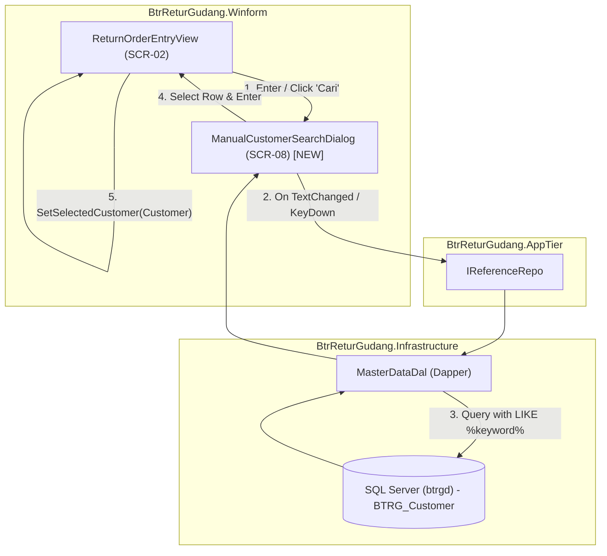

# Implementation Plan: Keyboard-Driven Modal Customer Search (Replacing ComboBox)

## Goal Description
In `src/j09-btr-retur-gudang/BtrReturGudang.sln`, customer selection in the Return Order Intake screen (`ReturnOrderEntryView`) currently loads all ~2,280 customer records synchronously from local SQL Server (`BTRG_Customer`) into a WinForms `ComboBox` with `AutoCompleteMode.SuggestAppend`. 

This creates significant operational and performance issues:
1. **Startup & Render Lag**: Initializing and rendering a WinForms `ComboBox` with 2,280 items locks the UI thread and incurs high memory overhead.
2. **Poor Disambiguation**: The single-line dropdown does not allow warehouse officers to easily differentiate customers with similar names across different regions (`Wilayah`) or customer codes (`CustomerCode`).
3. **Ergonomic Friction**: Keystroke search inside a native ComboBox dropdown is clunky and difficult to operate quickly via keyboard on warehouse workstations.

The objective is to replace the ComboBox with the same ergonomic pattern used for searching items (`ManualItemSearchDialog`):
- A dedicated keyboard-driven modal dialog: **`ManualCustomerSearchDialog`** (SCR-08).
- Asynchronous on-input keydown filtering against `BTRG_Customer` using `IReferenceRepo.SearchCustomerAsync(keyword)`.
- Smooth arrow-key navigation (Up/Down), Enter to confirm, Escape to cancel, and mouse double-click support.
- Low-resolution workstation compliance adhering to **TD-013** (760x480 max bounds, fit for 1280x720 screens).
- Seamless integration in `ReturnOrderEntryView` with a compact customer display field, a search trigger button (`Cari...`), `Enter` keydown trigger, and complete backwards compatibility for existing tests and manual text entries ("CUST-MANUAL").

---

## User Review Required

> [!IMPORTANT]
> **Keyboard Shortcut Alignment**:
> In `MainForm.cs`, global function keys are currently mapped as:
> - `F1`: Switch to Return Order Intake (`ReturnOrderEntryView`)
> - `F2`: Manual Item Search (`ManualItemSearchDialog`)
> - `F3`: Switch to Return Order List (`ReturnOrderListView`)
> - `F4`: Switch to Barcode Registry (`BarcodeRegistryView`)
> - `F5`: Switch to Settings (`SettingsView`)
>
> Within `ReturnOrderEntryView`, opening the customer search modal is triggered by:
> 1. **Focus + Enter** in the Customer text box (most natural keyboard flow: focus customer, type partial name/code, press `Enter`).
> 2. **Clicking the "🔍 Cari" button** next to the customer text box.
> 3. **Contextual shortcut (`F8`)**: Available within `ReturnOrderEntryView` for direct customer lookup without conflicting with global `F3`.

---

## Open Questions

> [!NOTE]
> 1. **Default Behavior on Open**: When the customer modal dialog opens, it immediately queries and displays initial customer records so the officer can immediately navigate with Down arrow without typing.
> 2. **Manual / Walk-in Customer Entry**: Preserved support for typing arbitrary walk-in customer names without selecting an existing master record (`CustomerId = "CUST-MANUAL"`).

---

## Proposed Changes

---

### Component: `BtrReturGudang.Winform`

#### [NEW] `src/j09-btr-retur-gudang/BtrReturGudang.Winform/Views/ManualCustomerSearchDialog.cs`
- Created `ManualCustomerSearchDialog : Form` adhering to the architectural standards of `ManualItemSearchDialog`:
  - **Form Styling**: `FormBorderStyle.FixedDialog`, `ClientSize = new Size(760, 480)`, `KeyPreview = true`, `StartPosition = FormStartPosition.CenterParent`.
  - **Header (44px, Slate900)**: Title `🔍 Cari Master Customer` and subtitle `Ketik kode, nama, atau wilayah customer. Gunakan panah Atas/Bawah dan tekan Enter untuk memilih.`
  - **Search Bar (54px, Slate50)**: `_txtSearch` with real-time `TextChanged` async search + `_btnSearch` ("Cari").
  - **DoubleBufferedDataGridView (`_dgvCustomers`)**:
    - `colCustCode`: "Kode Customer" (`CustomerCode` / `CustomerId`, MonospaceBold, width 115).
    - `colCustName`: "Nama Customer" (`CustomerName`, FillWeight 220, AutoSizeMode Fill).
    - `colWilayah`: "Wilayah / Kota" (`Wilayah`, width 130).
    - `colAlamat`: "Alamat" (`Alamat`, width 200).
  - **Keyboard Navigation**:
    - Arrow Up / Arrow Down on search box moves the selected row in `_dgvCustomers`.
    - Enter confirms selection and sets `DialogResult.OK`.
    - Escape closes dialog with `DialogResult.Cancel`.
    - Cell double-click confirms selection.
  - **Footer (72px, Slate50)**:
    - Selected customer label: `Customer Terpilih: [{CustomerCode}] {CustomerName}`.
    - Status label: `{N} customer ditemukan`.
    - Action buttons: `_btnSelect` ("Pilih (Enter)", Emerald) and `_btnCancel` ("Batal (Esc)").

#### [MODIFY] `src/j09-btr-retur-gudang/BtrReturGudang.Winform/Views/ReturnOrderEntryView.cs`
- Replaced `_cboCustomer` in the layout with a composite panel containing:
  - `_txtCustomer`: `TextBox` showing formatted customer info (e.g. `[CUST-001] TOKO MAKMUR SENTOSA - JAKARTA`) or custom walk-in text.
  - `_btnSearchCustomer`: `Button` (`"🔍 Cari"`, Slate700 background, White text).
- On-demand query: removed 2,280 item population in `LoadReferenceData()`.
- Customer selection logic with `SetSelectedCustomer(Customer)` and `TriggerCustomerSearch(string)`.
- Kept `CustomerComboBox` as synchronized shim for backwards compatibility.

---

### Component: `BtrReturGudang.Winform.Tests`

#### [NEW] `src/j09-btr-retur-gudang/BtrReturGudang.Winform.Tests/ManualCustomerSearchDialogTests.cs`
- 8 automated unit tests validating:
  1. Default initialization and null selection.
  2. Grid row population and default row selection.
  3. Keyword filtering across customer name, code, and region.
  4. Selection confirmation with `DialogResult.OK`.
  5. Arrow key navigation (Up/Down) through DataGridView rows.
  6. Dialog launcher hook integration in `ReturnOrderEntryView`.
  7. Return order draft persistence with customer code and region.
  8. Reset form clearing customer state.

---

### Component: Documentation

#### [MODIFY] `docs/features/return-order-desktop/feature.md`
- Added Acceptance Criteria 15 and updated Criterion 14 to include SCR-08 `ManualCustomerSearchDialog`.

#### [MODIFY] `docs/work/j09-btr-retur-gudang/BTR-RETUR-GUDANG-DESKTOP-ARCHITECTURE.md`
- Added SCR-08 (`ManualCustomerSearchDialog`) to Screen Design Inventory in Section 5.2.
