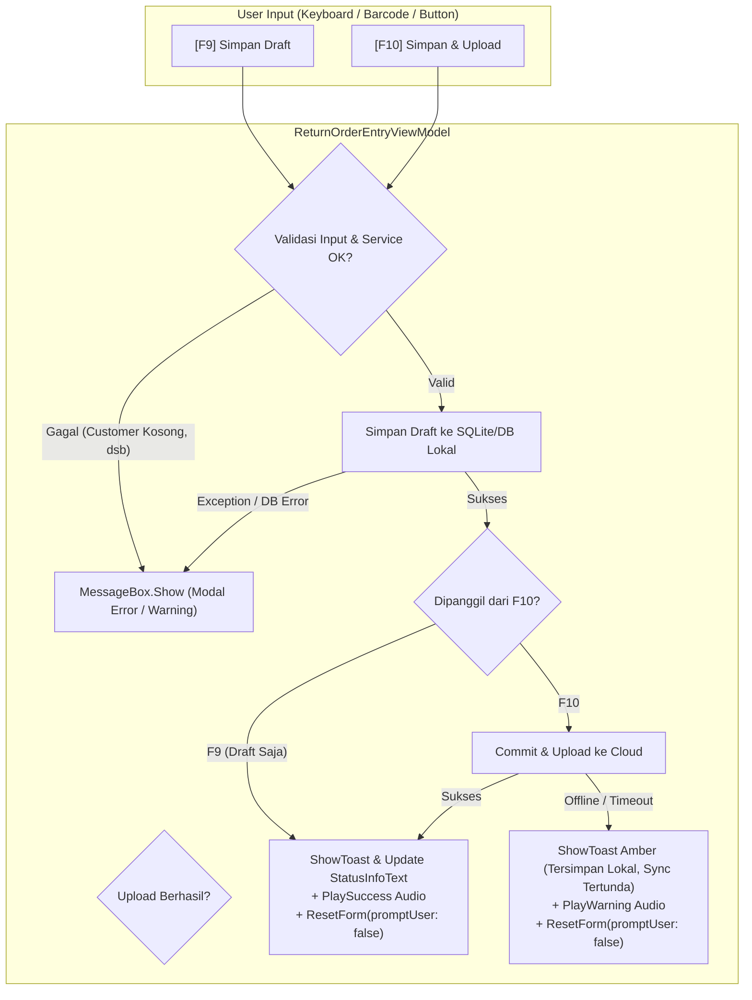

# Implementation Plan - Eliminasi MessageBox Sukses Simpan pada Intake Retur (BtrReturGudang.Wpf)

## Goal Description
Pada aplikasi **`BtrReturGudang.Wpf`** (menu **Intake Retur**), ketika operator gudang selesai menginput item retur dan melakukan penyimpanan (baik melalui tombol **[F9] Simpan Draft**, **[F10] Simpan & Upload**, maupun barcode scanner command), sistem saat ini memunculkan modal dialog `MessageBox.Show`.
Bahkan pada alur **Simpan & Upload**, operator harus menekan tombol "OK" pada `MessageBox` hingga **2 kali berturut-turut** (pertama saat penyimpanan draft lokal selesai, kedua saat upload ke Cloud selesai).

Hal ini menghambat efisiensi operasional penerimaan barang di gudang karena operator harus memindahkan tangan dari scanner / keyboard ke mouse untuk mengklik tombol "OK" berulang kali.

### Objectives
1. **Menghilangkan modal `MessageBox` untuk proses simpan yang sukses**:
   - Baik untuk simpan draft lokal (`SaveDraftAsync`) maupun simpan & upload (`SaveAndUploadAsync`).
   - Mencegah double notification dengan menambahkan parameter penekan notifikasi internal saat `SaveAndUploadAsync` memanggil `SaveDraftAsync`.
2. **Menampilkan pesan sukses secara non-intrusif**:
   - Menampilkan **In-App Toast Banner** di tampilan `ReturnOrderEntryView` (background hijau untuk sukses, otomatis hilang setelah ~3.5 detik tanpa mencuri fokus keyboard/scanner).
   - Memperbarui teks pada **Bottom Status Bar** (`StatusInfoText` pada `MainWindow`).
   - Mempertahankan audio feedback sukses (`_audioHelper.PlaySuccess()`).
   - Memastikan form di-reset secara bersih (`ResetForm(promptUser: false)`) sehingga siap untuk scan transaksi berikutnya secara instan.
3. **Mempertahankan `MessageBox` untuk kasus Error / Validasi**:
   - Jika validasi gagal (customer belum dipilih, daftar item masih kosong, workstation belum dikonfigurasi).
   - Jika terjadi exception / error database saat proses simpan.
   - Jika validasi sesi operator gagal (`OperatorSessionValidator.IsUnresolved`).

---

## User Review Required

> [!IMPORTANT]
> **Penanganan Status Offline pada Simpan & Upload:**
> Saat operator menekan `[F10] Simpan & Upload` namun koneksi internet sedang offline atau server relay tidak merespons:
> - Dokumen retur **tetap berhasil tersimpan di database lokal** (arsip offline aman).
> - Kami merekomendasikan status ini ditampilkan sebagai **Toast Amber/Peringatan + Status Bar** (misal: `"Tersimpan LOKAL ('RO-xxx'). Upload Cloud tertunda (offline)"`) dan form langsung di-reset agar operator tidak terhambat untuk melanjutkan scan fisik retur berikutnya.
> - Modal `MessageBox` hanya dimunculkan jika proses simpan lokal benar-benar **gagal/error**.

---

## Proposed Changes



---

### Component: `BtrReturGudang.Wpf`

#### [NEW] `Services/IStatusNotificationService.cs`
Layanan perantara (event-driven) yang menghubungkan view model modul dengan bottom status bar `MainWindow` dan komponen toast:
```csharp
namespace BtrReturGudang.Wpf.Services
{
    public enum NotificationType
    {
        Info,
        Success,
        Warning,
        Error
    }

    public class StatusNotificationEventArgs : EventArgs
    {
        public string Message { get; set; }
        public NotificationType Type { get; set; }
        public int DurationMs { get; set; }
    }

    public interface IStatusNotificationService
    {
        event EventHandler<StatusNotificationEventArgs> NotificationReceived;
        void ShowNotification(string message, NotificationType type = NotificationType.Info, int durationMs = 3500);
    }

    public class StatusNotificationService : IStatusNotificationService
    {
        public event EventHandler<StatusNotificationEventArgs> NotificationReceived;

        public void ShowNotification(string message, NotificationType type = NotificationType.Info, int durationMs = 3500)
        {
            NotificationReceived?.Invoke(this, new StatusNotificationEventArgs
            {
                Message = message,
                Type = type,
                DurationMs = durationMs
            });
        }
    }
}
```

#### [MODIFY] `App.xaml.cs`
Mendaftarkan `IStatusNotificationService` sebagai singleton di DI:
```csharp
services.AddSingleton<IStatusNotificationService, StatusNotificationService>();
```

#### [MODIFY] `ViewModels/MainViewModel.cs`
Menginjeksi `IStatusNotificationService` untuk otomatis memperbarui `StatusInfoText` pada bottom status bar:
```csharp
private readonly IStatusNotificationService _notificationService;

public MainViewModel(..., IStatusNotificationService notificationService = null)
{
    _notificationService = notificationService;
    if (_notificationService != null)
    {
        _notificationService.NotificationReceived += (s, e) =>
        {
            StatusInfoText = e.Message;
        };
    }
}
```

#### [MODIFY] `ViewModels/ReturnOrderEntryViewModel.cs`
1. Tambahkan property Toast dan dependency `IStatusNotificationService`:
   - `ToastMessage`, `IsToastVisible`, `ToastType`.
   - Method `ShowToast(string message, string type = "Success", int durationMs = 3500)`.
2. Refactor `SaveDraftAsync(bool suppressNotification = false)`:
   - Jika `suppressNotification == false`: panggil `_audioHelper?.PlaySuccess(); ShowToast(...); _notificationService?.ShowNotification(...)`.
   - **Hapus** `ShowMessage($"Draft Return Order '{CurrentReturnOrderId}' berhasil disimpan secara lokal.", "Sukses", "Information");`.
3. Refactor `SaveAndUploadAsync()`:
   - Panggil `var draftOrder = await SaveDraftAsync(suppressNotification: true);`. (Menghilangkan popup draft pertama).
   - Saat upload berhasil:
     - **Hapus** `ShowMessage(...)`.
     - Panggil `_audioHelper?.PlaySuccess(); ShowToast($"Return Order '{CurrentReturnOrderId}' berhasil disimpan dan di-upload ke server Cloud!", "Success");`.
     - Kirim notifikasi ke `_notificationService`.
     - Jalankan `ResetForm(promptUser: false)`.
   - Saat upload offline / tertunda:
     - **Hapus** `ShowMessage(...)`.
     - Tampilkan toast warning: `ShowToast($"Tersimpan LOKAL ('{CurrentReturnOrderId}'). Upload Cloud tertunda (koneksi offline).", "Warning");`.
     - Jalankan `ResetForm(promptUser: false)`.
4. Tetap pertahankan `ShowMessage(..., "Error" / "Warning")` untuk:
   - Validasi customer kosong
   - Validasi item kosong
   - Validasi identitas workstation
   - Error exception database / relay

#### [MODIFY] `Views/ReturnOrderEntryView.xaml`
Menambahkan visual elemen In-App Toast Notification pada bagian bawah view (tepat di atas Action Toolbar):
```xml
<!-- NON-INTRUSIVE FLOATING TOAST NOTIFICATION -->
<Border HorizontalAlignment="Right"
        VerticalAlignment="Bottom"
        Margin="0,0,16,56"
        CornerRadius="6"
        Padding="16,10"
        Panel.ZIndex="999"
        Effect="{DynamicResource Shadow.Dialog}">
    <Border.Style>
        <Style TargetType="{x:Type Border}">
            <Setter Property="Visibility" Value="Collapsed" />
            <Setter Property="Background" Value="{DynamicResource Brush.Slate.850}" />
            <Setter Property="BorderBrush" Value="{DynamicResource Brush.Slate.700}" />
            <Setter Property="BorderThickness" Value="1" />
            <Style.Triggers>
                <DataTrigger Binding="{Binding IsToastVisible}" Value="True">
                    <Setter Property="Visibility" Value="Visible" />
                </DataTrigger>
                <DataTrigger Binding="{Binding ToastType}" Value="Success">
                    <Setter Property="Background" Value="#065F46" />
                    <Setter Property="BorderBrush" Value="{DynamicResource Brush.Success}" />
                </DataTrigger>
                <DataTrigger Binding="{Binding ToastType}" Value="Warning">
                    <Setter Property="Background" Value="#78350F" />
                    <Setter Property="BorderBrush" Value="{DynamicResource Brush.Warning}" />
                </DataTrigger>
            </Style.Triggers>
        </Style>
    </Border.Style>
    <StackPanel Orientation="Horizontal" VerticalAlignment="Center">
        <TextBlock Text="{Binding ToastMessage}"
                   Foreground="{DynamicResource Brush.White}"
                   FontWeight="SemiBold"
                   FontSize="12.5" />
    </StackPanel>
</Border>
```

---

## Verification Plan

### Automated Tests
Jalankan pengujian unit test menggunakan dotnet CLI:
```powershell
dotnet test src/j09-btr-retur-gudang/BtrReturGudang.Wpf.Tests/BtrReturGudang.Wpf.Tests.csproj
```

Tambahkan test case baru pada `ReturnOrderEntryViewTests.cs`:
1. `SaveDraftAsync_Success_ShowsToastAndDispatchesStatusNotification_WithoutMessageBox`:
   - Setup customer dan item retur.
   - Jalankan `vm.SaveDraftAsync()`.
   - Assert `vm.IsToastVisible == true`, `vm.ToastType == "Success"`.
   - Assert `MessageDialogHandler` tidak dipanggil.
2. `SaveAndUploadAsync_Success_ShowsToastAndResetsForm_WithoutMessageBox`:
   - Setup customer dan item retur.
   - Jalankan `vm.SaveAndUploadAsync()`.
   - Assert `vm.IsToastVisible == true`, `vm.Items` kosong (ter-reset).
   - Assert `MessageDialogHandler` tidak dipanggil.
3. `SaveDraftAsync_ValidationError_StillShowsMessageBox`:
   - Kosongkan customer.
   - Jalankan `vm.SaveDraftAsync()`.
   - Assert `MessageDialogHandler` dipanggil dengan tipe `"Warning"`.

### Manual Verification
1. Jalankan aplikasi WPF:
   - Masuk ke menu **Intake Retur**.
   - Masukkan Customer dan scan satu barcode produk.
   - Tekan **[F9] Simpan Draft**:
     - Pastikan **tidak ada MessageBox** yang muncul.
     - Perhatikan toast hijau muncul di layar: *"Draft Return Order '...' berhasil disimpan secara lokal."*
     - Perhatikan teks di bottom status bar diperbarui.
   - Tekan **[F10] Simpan & Upload**:
     - Pastikan **tidak ada MessageBox** yang muncul sama sekali (0 klik mouse).
     - Form langsung bersih dan siap untuk scan berikutnya.
     - Toast sukses dan status bar menampilkan status upload berhasil.
   - Uji skenario error (klik Simpan saat form kosong):
     - Pastikan MessageBox error tetap muncul memperingatkan operator.
